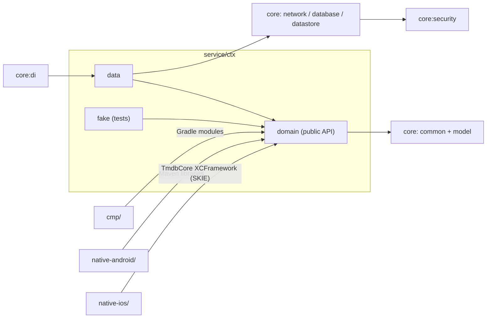
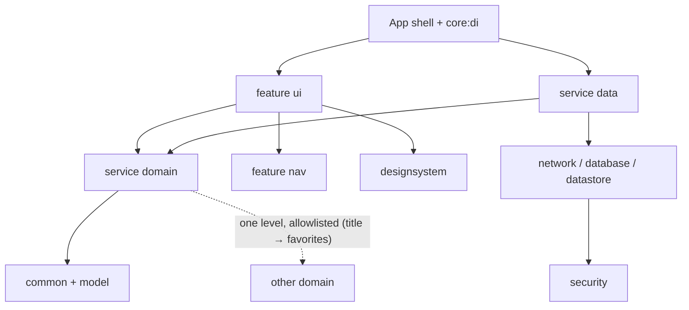
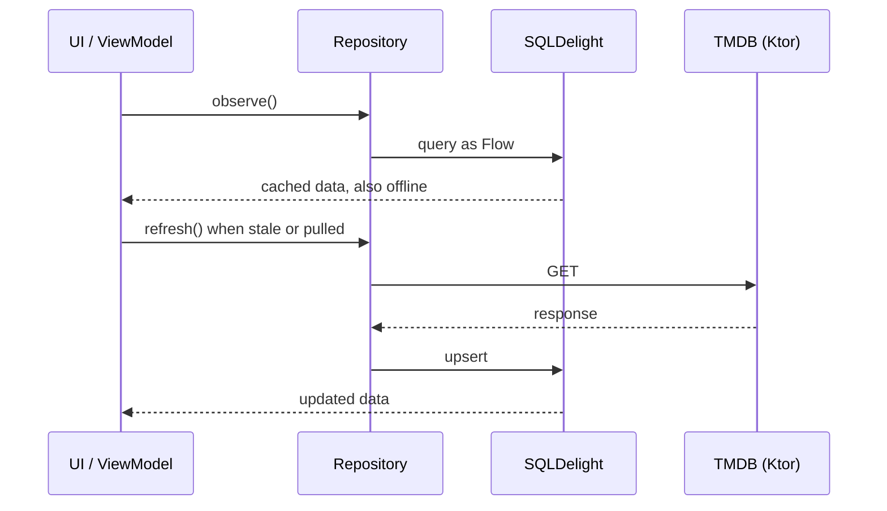
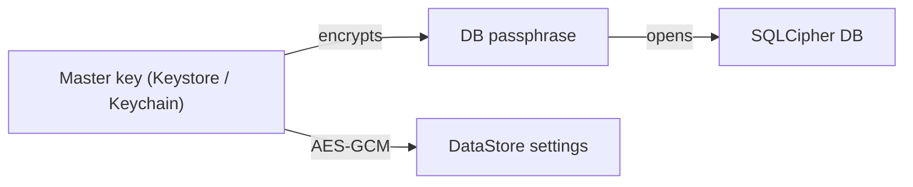

# kmp-tmdb-app

A Kotlin Multiplatform TMDB discovery app: one shared business core, three apps on top of it.

[](https://github.com/huuphuoc1396/kmp-tmdb-app/actions/workflows/ci.yml)


[](LICENSE)

## Overview

Find films, series, anime and novelas to watch, in English or Brazilian Portuguese.

- **Onboarding**: a welcome screen on first launch.
- **Home**: category tabs with featured and most popular rows, pull-to-refresh, works offline.
- **Title details**: artwork, rating, synopsis, cast, genres, recommendations and trailer.
- **Favorites**: save titles on the device, see them on Home and in "My favorites".

One Kotlin core (network, storage, business logic) backs three apps:

| App | UI | Gets the core as |
|---|---|---|
| [`cmp/`](cmp) | Compose Multiplatform, shared ViewModel + UI | Gradle modules |
| [`native-android/`](native-android) | Jetpack Compose | Published Android libraries |
| [`native-ios/`](native-ios) | SwiftUI | Swift Package with the `TmdbCore` XCFramework |

## Screenshots

| Onboarding | Home | Title details | Favorites |
|---|---|---|---|
|  |  |  |  |

Images: `docs/images/screenshots/<onboarding|home|title-details|favorites>.png`.

## Acknowledgements

- UI based on the [TMDB Figma community design](https://www.figma.com/community/file/1059842558004825230/tmdb).
- Data from the [TMDB API](https://developer.themoviedb.org/).

## Architecture

Full design: [`docs/architecture.md`](docs/architecture.md).

### Tiers

| Tier | Directory | Contains |
|---|---|---|
| Libraries | `core/` | Infrastructure: `common`, `model`, `security`, `network`, `database`, `datastore`, `di`, `ios`, `testing` |
| Services | `service/<context>/` | One business capability: `title`, `favorites`, `settings` |
| Features | `cmp/feature/<feature>/` | Screens: `onboarding`, `home`, `title-details` |

Each service has three modules:

- `domain`: models, repository interfaces, use cases. **The public API of the core**; apps see nothing else.
- `data`: repository implementations, TMDB endpoints, its own SQLDelight database, Koin module.
- `fake`: in-memory fakes for tests, checked by the same contract test as `data`.

A feature has a `ui` module (MVI ViewModel + screen) and, when needed, a `nav` module (route and arguments).
`core:di` and the app shells are the only places that wire implementations together.



### Module dependencies

Dependencies point inwards: `ui → domain`, `data → domain + infrastructure`, and only the composition roots see `data`.



Forbidden: `ui → ui`, `ui → data`, `data → data`, `domain → data/fake`, `fake` outside tests, core → app,
`native-*` → `cmp/`. The `tmdb.module` convention plugin fails the build on a forbidden module dependency, and Konsist
tests (`architecture-test/`) reject framework imports in `domain`/`model`/`nav` and packages that don't match the path.

### Offline-first

The UI always reads from the local database; the network only refreshes it.



- **Stale-while-revalidate**: TTL 6 h for home lists, 24 h for details.
- **Per language**: cache keyed by `en-US` / `pt-BR`.
- **Errors keep the cache**: failures become `AppError` (`Network`, `Unauthorized`, `NotFound`, `Unknown`) and never
  clear cached data.
- **Favorites** are local only.

## Project structure

```
build-logic/        Convention plugin tmdb.module
core/               Libraries
service/            title, favorites, settings (domain / data / fake)
cmp/                Compose Multiplatform app: designsystem, feature/, composeApp, androidApp, iosApp
native-android/     Standalone Android app, own Gradle build
native-ios/         Standalone iOS app, own Xcode project
architecture-test/  Konsist rules
docs/               architecture.md, feature specs
```

## Tech stack and decisions

Versions: [`gradle/libs.versions.toml`](gradle/libs.versions.toml).

### Local

| Choice | Why |
|---|---|
| SQLDelight, one database per service | Typed SQL on both platforms, observed as `Flow`; no cross-service joins |
| SQLCipher 4 | Encrypted databases on Android and iOS |
| DataStore + AES-GCM | Encrypted settings; `EncryptedSharedPreferences` is deprecated |

### Network

| Choice | Why |
|---|---|
| Ktor (OkHttp / Darwin) + kotlinx.serialization | One multiplatform client; `MockEngine` for tests |
| `apiCall { }` → `AppError` | Callers handle four error cases, not exceptions |
| Token injected at build time, obfuscated | Never in source; a client token can still be extracted, a backend proxy is the real fix |
| HTTPS only, no body logging in release, no pinning of TMDB | Pinning a third-party certificate breaks when it rotates |

### Security

| Choice | Why |
|---|---|
| Master key in Android Keystore / iOS Keychain | Never leaves the device |
| One random passphrase per database, encrypted with the master key | Opens the SQLCipher database; an unreadable database is recreated from TMDB |
| Databases and keys excluded from OS backups | A restored database without its key can't be opened |



### Other

Koin (DI), Compose Multiplatform / Jetpack Compose / SwiftUI, Coil 3 / Nuke (images), SKIE (Swift-friendly Kotlin
API), Detekt + ktlint, Kover (80% on `domain` / `data`), Konsist.

## Getting started

Requirements: JDK 21, Android SDK (`sdk.dir` in `local.properties`), and macOS + Xcode 16+ for iOS (without them the
iOS targets are skipped).

Add your TMDB **API Read Access Token** as `TMDB_ACCESS_TOKEN` in `secrets.properties` (env var on CI); without it,
TMDB calls fail with `Unauthorized`:

```bash
cp secrets.properties.example secrets.properties
```

**cmp**: Android with the command below; iOS by opening `cmp/iosApp/iosApp.xcodeproj` in Xcode.

```bash
./gradlew :cmp:androidApp:installDebug
```

**native-android / native-ios**: publish the shared core, then open `native-android/` in Android Studio or
`native-ios/TmdbNative.xcodeproj` in Xcode and run. Details in [`native-android/README.md`](native-android/README.md)
and [`native-ios/README.md`](native-ios/README.md).

```bash
./gradlew publishSharedCore
```

## Testing and CI

- Unit tests run as Android host tests (JVM) by default; `commonTest` only for code Kotlin/Native may run differently.
- No mocking library: service fakes, in-memory SQLDelight, Ktor `MockEngine`.
- Keystore, Keychain and SQLCipher drivers are tested on a device and simulator, locally.

All CI checks (Detekt, host tests, Kover, Konsist):

```bash
./gradlew detekt testAndroidHostTest koverVerify :architecture-test:test
```

One module:

```bash
./gradlew :<module>:testAndroidHostTest
```

CI ([`ci.yml`](.github/workflows/ci.yml)) runs these checks on Ubuntu for pushes and pull requests to `main`. App
builds, device / simulator tests and the native apps run locally.

## License

MIT — see [LICENSE](LICENSE).

## Disclaimer

This product uses the TMDB API but is not endorsed or certified by [TMDB](https://www.themoviedb.org/).
