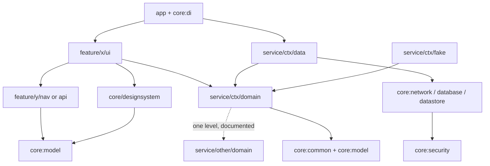

# Architecture

An entertainment discovery app (films, series, anime, novelas) in **English and Portuguese (pt-BR)**, built with **Kotlin Multiplatform** on top of the TMDB API.

The repository shows **two levels of code sharing** between Android and iOS, built on the same shared core:

| Branch | Network | Local | Business logic | ViewModel | UI |
|---|---|---|---|---|---|
| `main` | shared | shared | shared | — | — |
| `cmp` | shared | shared | shared | **shared** (KMP ViewModel) | **shared** (Compose Multiplatform) |
| `native` | shared | shared | shared | per platform (Android ViewModel / Swift `@Observable`) | per platform (Jetpack Compose / SwiftUI) |

---

## 1. Product scope

Three screens, all with a dark theme, purple accents, readable typography and vertical scrolling where needed.

1. **Onboarding**: full-screen cinematic artwork, a short value proposition, and an **"Acessar"** button.
2. **Home**: search field, category tabs (Filmes, Séries, Anime, Novelas), featured poster carousels, a **"Mais populares"** section, and a profile entry point. Tapping a title opens its details.
3. **Title details**: artwork, name, release year, rating, runtime, synopsis, main cast, genres and recommendations, plus back navigation, a favorite toggle and an **"Assistir trailer"** action.

### Category mapping (TMDB)

| Category | Source |
|---|---|
| Filmes | `/movie/*`, `/discover/movie` |
| Séries | `/tv/*`, `/discover/tv` |
| Anime | `/discover/tv?with_genres=16&with_original_language=ja` |
| Novelas | `/discover/tv?with_genres=10766&with_origin_country=BR\|MX` |

Content language follows the device locale (`language=pt-BR` or `en-US`). The cached content for each language is stored separately.

---

## 2. Branch strategy

```
main     ── shared core (KMP libraries) + docs + CI for core
 ├── cmp      ── merges from main; adds shared ViewModels + Compose Multiplatform UI
 └── native   ── merges from main; adds Android (Compose + ViewModel) and iOS (SwiftUI + Swift VM via SKIE)
```

Rules:

- Changes to `build-logic/`, `core/*` or `service/*` are made on `main` first, then merged into `cmp` and `native`.
- `cmp` and `native` never merge into each other or back into `main`.
- `main` has no app module. It builds and tests on the JVM target only, with no emulator or Xcode required.

---

## 3. Targets

All shared modules target `androidTarget`, `iosArm64`, `iosSimulatorArm64` and `jvm`.

`jvm` exists mainly for **fast tests**: every unit test runs on it (see section 8), along with SQLDelight in-memory, Compose UI and screenshot tests. On `cmp` it can also run a desktop app at almost no extra cost.

---

## 4. Module structure

Modules are grouped in three tiers, following the patterns large Android codebases use (Airbnb: feature + nav modules; Square: public / impl / fake; Slack: Features / Services / Libraries):

| Tier | Directory | Contains |
|---|---|---|
| Libraries | `core/` | Infrastructure and a small shared kernel; no business features |
| Services | `service/<context>/` | One business capability (bounded context): `domain`, `data`, `fake` |
| Features | `feature/<feature>/` (`cmp`) or platform folders (`native`) | Screens: `ui` (ViewModel + screen) and, when needed, `nav` / `api` |

`core:di` (on every branch) and the app module (on `cmp` / `native`) are the **composition roots**: the only modules that see every implementation.

> **Status:** `main` has the `core/*` modules only. The `service/*` tree below is the target: each context, and each `fake` module, is created by the first feature that needs it (4.5).

### 4.1 Shared core (`main`, identical on every branch)

```
build-logic/convention/   # tmdb.module (type from path + dependency rules), tmdb.detekt
architecture-test/        # Konsist rules for imports and packages (JVM only)
core/                     # Libraries
├── common/      # AppResult, AppError, DispatcherProvider
├── model/       # Shared kernel: TitleId, GenreId, Title, Genre, Language
├── network/     # Ktor client factory, auth, certificate pinning, error mapping (no endpoints)
├── database/    # One SQLDelight schema + DatabaseDriverFactory (expect/actual)
├── datastore/   # DataStore KMP with an encrypted serializer
├── security/    # Master key: Android Keystore / iOS Keychain / JVM fake; AES-GCM
├── testing/     # Test dispatchers
└── di/          # initKoin(); collects the Koin module of every service/*/data
service/                  # Services (created on demand)
├── title/       # Home lists, details, cast, videos, genres, search
│   ├── domain/  # TitleDetails, Cast, Video, Category; TitleRepository; ObserveHomeFeed, RefreshHomeFeed
│   ├── data/    # TitleRepositoryImpl, TMDB endpoints + DTOs, mappers, queries, refresh policy, Koin module
│   └── fake/    # FakeTitleRepository, TitleRepositoryContract
├── favorites/   # Local-only favorites
│   ├── domain/  # FavoritesRepository
│   └── data/    # FavoritesRepositoryImpl
└── settings/    # Content language, onboarding state
    ├── domain/  # SettingsRepository
    └── data/    # SettingsRepositoryImpl (DataStore)
```

Example layout of one service context:

```
service/title/
├── domain/src/commonMain/kotlin/com/banhmilabs/tmdb/service/title/domain/
│   ├── model/        TitleDetails.kt, Cast.kt, Video.kt, Category.kt
│   ├── TitleRepository.kt
│   └── usecase/      ObserveHomeFeed.kt, RefreshHomeFeed.kt
├── data/src/
│   ├── commonMain/kotlin/com/banhmilabs/tmdb/service/title/data/
│   │   ├── remote/   TmdbTitleApi.kt, dto/
│   │   ├── local/    TitleLocalDataSource.kt
│   │   ├── mapper/   TitleMapper.kt
│   │   ├── RefreshPolicy.kt
│   │   ├── TitleRepositoryImpl.kt
│   │   └── di/TitleDataModule.kt
│   └── jvmTest/      TitleRepositoryImplTest.kt (extends the contract), resources/fixtures/*.json
└── fake/src/
    ├── commonMain/kotlin/com/banhmilabs/tmdb/service/title/fake/
    │   ├── FakeTitleRepository.kt
    │   └── TitleRepositoryContract.kt
    └── jvmTest/      FakeTitleRepositoryTest.kt (extends the contract)
```

Gradle paths, accessors and packages follow the directory: `service/title/domain` → `:service:title:domain` → `projects.service.title.domain` → package `com.banhmilabs.tmdb.service.title.domain`. Because several modules share a leaf name (`domain`, `data`, `ui`), the convention plugin gives each one a unique module name from its path (for example `service-title-domain`) so Kotlin/Native klibs and artifacts don't clash.

The **public API of the shared core** is the set of `service/*/domain` modules: repository interfaces, use cases and their models. Platforms never see `data`, `network` or `database`.

### 4.2 Module types

| Path | Type | Contains |
|---|---|---|
| `core/common`, `core/model` | kernel | Technical primitives; models shared by two or more contexts |
| `core/network`, `core/database`, `core/datastore`, `core/security` | infra | Infrastructure, `expect`/`actual` |
| `core/designsystem` (`cmp`) | designsystem | Theme, stateless UI components used by two or more features, image loading, `UiText`, Compose resources |
| `core/testing` | testing | Shared test utilities |
| `core/di`, app module | root | Wiring |
| `service/<ctx>/domain` | domain | Context models, repository interfaces, use cases |
| `service/<ctx>/data` | data | Repository implementations, endpoints + DTOs, mappers, queries, Koin module |
| `service/<ctx>/fake` | fake | In-memory repository fakes + the repository contract test |
| `feature/<x>/nav` | nav | Route, Args, Result only |
| `feature/<x>/api` | api | `nav` plus entry interfaces (for example a `@Composable` entry); replaces `nav` when needed |
| `feature/<x>/ui` | ui | ViewModel, screen, implementations of the feature's entries |

### 4.3 Dependency rules



Allowed dependencies (everything not listed is forbidden):

| Type | May depend on |
|---|---|
| `core:common`, `core:model` | nothing |
| infra | kernel, `core:security` |
| designsystem | `core:model` |
| domain | kernel, another context's `domain` (one level, see below) |
| data | its own context's `domain`, kernel, infra |
| fake | its own context's `domain`, kernel |
| nav, api | `core:model` |
| ui | its own and other features' `nav` / `api`, `service/*/domain`, designsystem, kernel |
| testing | kernel |
| root | everything |
| test source sets (`jvmTest`) | additionally `service/*/fake`, `core:testing` |

Forbidden in particular: `ui → ui`, `ui → data`, `ui → infra`, `data → data`, `fake → data`, `domain → data` / `fake`, and `fake` outside test source sets (or a demo app).

**`domain → domain`:**

1. Only to another context's `domain`, never to its `data` or `fake`.
2. One level only: a `domain` that another context depends on depends on no other `domain`.
3. Each one is listed here with its reason. Current list:
   - `service/title/domain → service/favorites/domain`: `ObserveHomeFeed` adds the favorite flag to home titles.
4. When one context depends on three or more other domains, the combining logic moves to its own context (for example `service/home/domain`).

**When feature A needs something from feature B** (never `ui → ui`), in this order:

1. Data or logic: use `service/*/domain` directly.
2. A stateless component: move it to `core/designsystem`.
3. A stateful component owned by B: A's screen takes a `@Composable` slot, and the app module passes B's composable (a `@ViewBuilder` closure on SwiftUI).
4. When a slot is not enough (the component sits deep in A's tree): rename B's `nav` to `api`, declare an entry interface there, implement it in `B/ui` and bind it with Koin.

Navigation between features goes through the target feature's `nav` module; the app module builds the navigation graph.

`domain`, `core:model` and `nav` import no frameworks (Ktor, SQLDelight, Compose, `androidx.`, Koin, `android.`, `platform.`). `api` may use the Compose runtime for `@Composable` entry interfaces.

### 4.4 Models and use cases

- A model goes in `core:model` only when **two or more contexts** need it, or a `nav` / `api` module does (for example `TitleId` in `DetailsRoute`). Modules of the same context and features that reach it through a `domain` don't count. Everything else stays in its context's `domain`.
- **Use cases are optional.** A ViewModel may call a repository interface directly when it only forwards (`observe…`, `refresh…`, `toggle…`). Create a use case only when it:
  1. combines two or more repositories,
  2. applies business rules (filtering, sorting, merging, validation, aggregating refresh errors),
  3. shapes data for a screen that both platforms need, or
  4. is reused by two or more features.

  The reason: on `native` the ViewModel exists twice (Kotlin and Swift), so any logic outside the core is written twice.
- A use case is a class with `operator fun invoke`, with no interface. Never create a use case that only forwards.
- Repository interfaces expose only operations consumers need (`observe`, `refresh`, `toggle`, `set`). Internal operations such as `upsert` stay in `data`.
- Time comes from an injected `kotlin.time.Clock` (check it is stable for the project's Kotlin version; otherwise add a `Clock` to `core:common`). Dispatchers come from `DispatcherProvider`.

### 4.5 Creating modules on demand

The target structure is fixed, but a module is created only when it is needed:

| Module | Create when |
|---|---|
| `service/<ctx>/fake` | Tests or a demo of another module need that context's fake repository |
| `feature/<x>/nav` | Another feature navigates to this feature; until then the route lives in `ui` |
| `feature/<x>/api` (rename of `nav`) | The feature must expose an entry component (rule 4 above) |
| `core/designsystem` | The first stateless component is used by two features |
| A new service context | It has its own repository and use cases; until then it stays in the nearest context (search lives in `title`) |
| A per-feature demo app | Building the full app slows down feature development |

### 4.6 Enforcement

| Rule | Checked by |
|---|---|
| Module type from path; unknown paths rejected | `tmdb.module` (`moduleTypeOf` in `build-logic`) |
| Allowed dependencies (4.3 table), `domain → domain` allowlist and its one-level depth | `tmdb.module` (`DependencyRules` in `build-logic`): a forbidden `project(...)` dependency fails configuration with `Rule: <from> -> <to>: …` |
| No framework imports; package matches the path; import rules | Konsist (`architecture-test`), over `core/`, `service/` and `feature/` |
| Unique module names per path | `tmdb.module` sets `group` to the parent package of the path |

Every shared module applies only `alias(libs.plugins.tmdb.module)`; KMP targets, Detekt and (for `domain` / `data`) Kover come from its type. The `domain → domain` allowlist is `DependencyRules.domainAllowlist`; adding a pair there and to the list in 4.3 is the only way to allow one. The rule table and type parsing have unit tests in `build-logic`, run by `./gradlew jvmTest`.

### 4.7 `cmp` branch: share everything

```
core/designsystem/        # CMP theme (dark, purple), typography, stateless components,
                          # Coil 3 image loading, UiText, Compose resources (en, pt-BR)
feature/onboarding/ui/    # OnboardingRoute, OnboardingViewModel, OnboardingScreen
feature/home/ui/          # HomeRoute, HomeViewModel, HomeScreen
feature/details/
├── nav/                  # DetailsRoute(titleId: TitleId)
└── ui/                   # DetailsViewModel, DetailsScreen
composeApp/               # App(), type-safe Navigation Compose, slots between features, MainViewController() for iOS
androidApp/               # MainActivity, Application
iosApp/                   # Hosts ComposeUIViewController only
desktopApp/               # optional
```

ViewModels use androidx.lifecycle KMP. A feature's `ui` module holds its route until another feature needs it, then the route moves to `nav`.

### 4.8 `native` branch: native UI and ViewModel on each platform

```
android/
├── designsystem/         # Jetpack Compose Material 3 theme + components
├── feature/onboarding/ui/
├── feature/home/ui/
├── feature/details/{nav,ui}/
└── app/                  # MainActivity, Navigation Compose, Koin start
shared/                   # iOS umbrella framework: exports core:common, core:model and service/*/domain
                          # (debug builds also export service/*/fake for SwiftUI previews and tests); SKIE; KoinHelper
iosApp/
├── DI/                   # Swift access to repositories and use cases via KoinHelper
├── DesignSystem/         # SwiftUI theme + components
├── Features/Onboarding|Home|Details/   # Swift packages: @Observable ViewModel + SwiftUI View
└── Localizable.xcstrings # en, pt-BR
```

Feature rules are the same on both platforms: features never import each other's UI; they share data through `service/*/domain` and navigate through routes.

**How SKIE is used on iOS:**

- `Flow<T>` becomes an `AsyncSequence`, so a Swift ViewModel can write `for await feed in observeHomeFeed() { ... }` inside a `Task`.
- `suspend` functions become `async throws`.
- `sealed` hierarchies (for example `AppError`) can be matched exhaustively with `switch onEnum(of:)`.
- Kotlin enums become Swift enums, and default arguments are preserved.

An iOS app links **exactly one** Kotlin umbrella framework, to avoid duplicating the Kotlin runtime and types.

---

## 5. Offline-first data flow

```
UI ◄── ViewModel ◄── (UseCase) ◄── Repository.observe()  ◄── SQLDelight (single source of truth)
                                   Repository.refresh() ──► Ktor ──► upsert into SQLDelight
```

A use case sits in between only when it adds logic (see 4.4); otherwise the ViewModel calls the repository interface directly. Repository interfaces live in `service/<ctx>/domain`, their implementations in `service/<ctx>/data`.

- **Reads** always come from the database (`query.asFlow().mapToList(dispatcher)`). The network never feeds the UI directly.
- **Refresh** uses stale-while-revalidate. Each list stores `fetchedAt`, and a refresh runs when the data is older than its TTL (for example, home lists after 6 hours and details after 24 hours) or when the user pulls to refresh.
- **Favorites** are local only and work fully offline.
- **Search** needs the network. Recent queries and the last results are cached.
- **Connectivity** is observed per platform (`ConnectivityManager` / `NWPathMonitor`). The UI shows an offline banner and keeps showing cached content.
- **Errors** are mapped to `AppError` (Network, Unauthorized, NotFound, Unknown). An error never clears cached data.
- **Images**: Coil 3 with a disk cache (Compose). The SwiftUI app uses an image library with a disk cache, because `AsyncImage` does not cache to disk.

### Database schema (SQLDelight)

| Table | Purpose |
|---|---|
| `title` | Shared title rows (id, mediaType, name, posterPath, backdropPath, rating, year, language) |
| `title_list` | Membership of a list: `(listKey, language, position, titleId, fetchedAt)`, where `listKey` is for example `ANIME_FEATURED` |
| `title_detail` | Runtime, synopsis, genres, trailer key, `fetchedAt` |
| `cast_member` | Main cast for each title |
| `recommendation` | `(titleId, recommendedId, position)` |
| `favorite` | `(titleId, addedAt)` |
| `recent_search` | `(query, searchedAt)` |

---

## 6. Security

### 6.1 Hiding the API key

Any key shipped inside a client app can be extracted. This project makes extraction harder and keeps the key out of source control:

1. The TMDB read token lives in `secrets.properties`, which is git-ignored. On CI it comes from GitHub Actions secrets.
2. At build time, Gradle generates the key as an **XOR-obfuscated byte array with a random per-build salt**, so it never appears as a plaintext string in source or in the binary.
3. Android uses R8 shrinking and obfuscation. iOS compiles Kotlin to a native binary.
4. In production, the right fix is a **backend proxy** (for example a Cloudflare Worker) that keeps the token server-side. This is documented as the recommended next step.

Network hardening: HTTPS only, certificate pinning for `api.themoviedb.org`, and no request or response body logging in release builds.

### 6.2 Encrypted local settings

- `core:security` provides a **master key** through expect/actual:
  - Android: AES-256 key in Android Keystore (non-exportable).
  - iOS: key stored in Keychain with `kSecAttrAccessibleAfterFirstUnlockThisDeviceOnly`.
  - JVM: in-memory fake for tests.
- `core:datastore` uses DataStore KMP with a custom `OkioSerializer` that encrypts and decrypts the serialized settings with **AES-GCM** (via `cryptography-kotlin`).
- `EncryptedSharedPreferences` is not used because it is deprecated.

### 6.3 Database encryption (planned)

The current phase uses **plain SQLDelight**. The API is designed so that SQLCipher can be added later without changing the architecture:

- `DatabaseDriverFactory.create(passphrase: ByteArray?)` already takes a passphrase, generated once and protected by the master key.
- Planned spike:
  - Android: `AndroidSqliteDriver(factory = SupportOpenHelperFactory(passphrase))` with `net.zetetic:sqlcipher-android`.
  - iOS: `NativeSqliteDriver` with `encryptionConfig`, linking SQLCipher instead of the system `sqlite3`.

---

## 7. Localization

| Layer | en / pt-BR strings |
|---|---|
| TMDB content | `language` query parameter, cached per language |
| `cmp` UI | Compose Multiplatform resources (`values/`, `values-pt-rBR/`) |
| `native` Android UI | Android resources (`values/`, `values-pt-rBR/`) |
| `native` iOS UI | String Catalog (`Localizable.xcstrings`) |

---

## 8. Testing strategy

| Level | Tools | Runs on |
|---|---|---|
| Domain and data unit tests | `kotlin.test`, Turbine, Kotest assertions, service fakes, MockK | `jvmTest` |
| Network | Ktor `MockEngine` + fixture JSON (in each `data` module's test resources) | `jvmTest` |
| Database | SQLDelight in-memory driver (`JdbcSqliteDriver`), real database, not mocked | `jvmTest` |
| Platform code (`actual`: Keystore, Keychain, SQLite drivers, Ktor engines, certificate pinning) | Android: instrumented tests. iOS: `kotlin.test`, no mocks | Android emulator/device, iOS simulator (local only) |
| Repository fakes | Contract test shared by `data` and `fake` | `jvmTest` |
| Shared ViewModels (`cmp`) | `kotlinx-coroutines-test`, Turbine, service fakes, MockK | `jvmTest` |
| Compose UI (`cmp`) | `runComposeUiTest` | JVM |
| Screenshots | Roborazzi | JVM (`cmp`), Robolectric (`native` Android) |
| Android unit and UI (`native`) | MockK, Compose UI test + Robolectric | JVM |
| iOS (`native`) | XCTest for Swift ViewModels (service fakes from the debug framework); XCUITest for flows | iOS simulator |
| Architecture | Konsist | JVM |
| Coverage and static analysis | Kover, Detekt | CI |

Rules:

- Unit tests for shared code live **only in `jvmTest`**. `commonTest` contains no tests. JVM tests are fast and can use MockK, which supports only the JVM.
- **Test doubles across modules are the service fakes.** Each `service/<ctx>/fake` module holds an in-memory, controllable fake per repository interface (for example `FakeTitleRepository` backed by `MutableStateFlow`). A ViewModel or use case test uses the real use cases on top of a fake repository, so business logic is still exercised.
- **Fakes are kept honest by contract tests.** An abstract `<Repository>Contract` class in the `fake` module describes the required behavior; both `data` (`<Repository>ImplTest`) and `fake` (`Fake<Repository>Test`) extend it.
- **MockK** is used for collaborators inside the same module and for verifying interactions. There are no other hand-written fakes (no ad-hoc `Fake*` classes in test code) and no Mokkery.
- Ktor `MockEngine` and the in-memory SQLDelight driver are test engines, not fakes, and stay in use; the database and HTTP client are never mocked.
- `core:testing` holds test dispatchers. Fixture JSON lives in each `data` module's `jvmTest` resources.
- **Platform code is tested on its platform**, locally and not on `main` CI: Android `actual` code with instrumented tests, iOS `actual` code on the simulator with `kotlin.test`. MockK is never used there.
- Trade-off: differences between the Kotlin/Native and JVM runtimes are not caught by unit tests. Platform tests and iOS XCTest on `native` cover them.

---

## 9. Tech stack

| Area | Choice |
|---|---|
| Language | Kotlin 2.x (K2), Swift 6 |
| UI | Compose Multiplatform (`cmp`); Jetpack Compose + SwiftUI (`native`) |
| Navigation | Navigation Compose (type-safe); SwiftUI `NavigationStack` |
| DI | Koin |
| Networking | Ktor Client (OkHttp / Darwin engines), kotlinx.serialization |
| Database | SQLDelight (SQLCipher planned) |
| Settings | DataStore KMP + AES-GCM (`cryptography-kotlin`) |
| Images | Coil 3 |
| iOS interop | SKIE |
| Testing | `kotlin.test`, MockK, Turbine, Kotest assertions (JVM); Konsist; Kover |
| Build | Gradle version catalog, convention plugins in `build-logic` |
| CI | GitHub Actions: Ubuntu for JVM/Android, macOS for iOS |

---

## 10. CI

| Branch | Jobs |
|---|---|
| `main` | `detekt`, `jvmTest`, `koverVerify`, `:architecture-test:test` on Ubuntu (JVM only) |
| `cmp` | All jobs from `main` + JVM Compose UI and screenshot tests + `assembleDebug` + iOS framework build |
| `native` | All jobs from `main` + Android unit, UI and screenshot tests + `xcodebuild test` (macOS) |

On `main`, Android and iOS targets are compiled locally, not on CI. Platform tests (Android instrumented, iOS simulator) also run locally only.

### Running checks locally

```bash
# Same checks as CI (JVM only)
./gradlew detekt jvmTest koverVerify :architecture-test:test

# Compile every target: Android, iOS arm64, iOS simulator arm64, JVM (needs macOS + Xcode)
./gradlew assemble
```

---

## 11. Roadmap

1. **`main`**: build-logic, `core/*` modules, JVM tests running, CI. Done, including the `tmdb.module` plugin and dependency rules (section 4); service contexts arrive with features.
2. **`cmp`**: design system, then the three screens, then UI tests.
3. **`native`**: Android screens, then the SwiftUI app with SKIE, then XCTest/XCUITest.
4. **Spike**: SQLCipher with SQLDelight on Android and iOS.
5. **Optional**: TMDB backend proxy.
