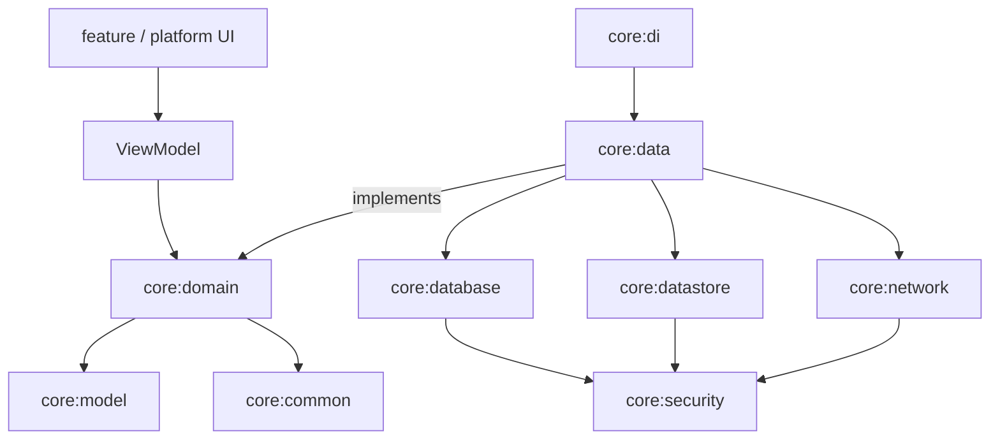

# Architecture

An entertainment discovery app (films, series, anime, novelas) in **English and Portuguese (pt-BR)**, built with **Kotlin Multiplatform** on top of the TMDB API.

The repository shows **two levels of code sharing** between Android and iOS, built on the same shared core:

| Branch | Network | Local | Business logic | ViewModel | UI |
|---|---|---|---|---|---|
| `main` | shared | shared | shared | — | — |
| `cmp` | shared | shared | shared | **shared** (KMP ViewModel) | **shared** (Compose Multiplatform) |
| `native` | shared | shared | shared | per platform (Android ViewModel / Swift `@Observable`) | per platform (Jetpack Compose / SwiftUI) |

---

## 1. Product scope

Three screens, all with a dark theme, purple accents, readable typography and vertical scrolling where needed.

1. **Onboarding**: full-screen cinematic artwork, a short value proposition, and an **"Acessar"** button.
2. **Home**: search field, category tabs (Filmes, Séries, Anime, Novelas), featured poster carousels, a **"Mais populares"** section, and a profile entry point. Tapping a title opens its details.
3. **Title details**: artwork, name, release year, rating, runtime, synopsis, main cast, genres and recommendations, plus back navigation, a favorite toggle and an **"Assistir trailer"** action.

### Category mapping (TMDB)

| Category | Source |
|---|---|
| Filmes | `/movie/*`, `/discover/movie` |
| Séries | `/tv/*`, `/discover/tv` |
| Anime | `/discover/tv?with_genres=16&with_original_language=ja` |
| Novelas | `/discover/tv?with_genres=10766&with_origin_country=BR\|MX` |

Content language follows the device locale (`language=pt-BR` or `en-US`). The cached content for each language is stored separately.

---

## 2. Branch strategy

```
main     ── shared core (KMP libraries) + docs + CI for core
 ├── cmp      ── merges from main; adds shared ViewModels + Compose Multiplatform UI
 └── native   ── merges from main; adds Android (Compose + ViewModel) and iOS (SwiftUI + Swift VM via SKIE)
```

Rules:

- Changes to `build-logic/` or `core/*` are made on `main` first, then merged into `cmp` and `native`.
- `cmp` and `native` never merge into each other or back into `main`.
- `main` has no app module. It builds and tests on the JVM target only, with no emulator or Xcode required.

---

## 3. Targets

All shared modules target `androidTarget`, `iosArm64`, `iosSimulatorArm64` and `jvm`.

`jvm` exists mainly for **fast tests**: every unit test runs on it (see section 8), along with SQLDelight in-memory, Compose UI and screenshot tests. On `cmp` it can also run a desktop app at almost no extra cost.

---

## 4. Module structure

### 4.1 Shared core (`main`, identical on every branch)

```
build-logic/convention/   # Convention plugins: kmp.library, kover, detekt, (cmp.feature, android.app on branches)
architecture-test/        # Konsist tests that enforce the dependency rules in 4.4 (JVM only)
core/
├── common/      # AppResult, AppError, DispatcherProvider, Clock
├── model/       # Title, TitleDetails, Cast, Genre, Category, Video (pure Kotlin)
├── domain/      # Repository interfaces + use cases
├── network/     # Ktor client, DTOs, TMDB API, auth, certificate pinning
├── database/    # SQLDelight schema + DatabaseDriverFactory (expect/actual)
├── datastore/   # DataStore KMP with an encrypted serializer (app settings)
├── security/    # Key management: Android Keystore / iOS Keychain / JVM fake; AES-GCM
├── data/        # Offline-first repository implementations, mappers, refresh policy
├── di/          # Koin modules for core + initKoin()
└── testing/     # Fixture JSON, test dispatchers (no fakes; see section 8)
```

Use cases are the **public API of the shared core**. The `native` branch consumes the core only through them.

Examples: `ObserveHomeFeed`, `RefreshHomeFeed`, `SearchTitles`, `ObserveTitleDetails`, `RefreshTitleDetails`, `ToggleFavorite`, `ObserveFavorites`, `CompleteOnboarding`, `ObserveOnboardingCompleted`.

### 4.2 `cmp` branch: share everything

```
core/designsystem/        # CMP theme (dark, purple), typography, components
core/ui/                  # Coil 3 image loading, UiText, Compose resources (en, pt-BR)
feature/onboarding/       # ViewModel (androidx.lifecycle KMP) + Composables
feature/home/
feature/details/
composeApp/               # App(), type-safe Navigation Compose, MainViewController() for iOS
androidApp/               # MainActivity, Application
iosApp/                   # Hosts ComposeUIViewController only
desktopApp/               # optional
```

### 4.3 `native` branch: native UI and ViewModel on each platform

```
android/
├── designsystem/         # Jetpack Compose Material 3 theme + components
├── feature/onboarding/   # androidx ViewModel + Compose screen
├── feature/home/
├── feature/details/
└── app/                  # MainActivity, Navigation Compose, Koin start
shared/                   # iOS umbrella framework: exports core:domain + core:model; SKIE enabled; KoinHelper
iosApp/
├── DI/                   # Swift access to use cases via KoinHelper
├── DesignSystem/         # SwiftUI theme + components
├── Features/Onboarding|Home|Details/   # @Observable ViewModel + SwiftUI View
└── Localizable.xcstrings # en, pt-BR
```

**How SKIE is used on iOS:**

- `Flow<T>` becomes an `AsyncSequence`, so a Swift ViewModel can write `for await feed in observeHomeFeed() { ... }` inside a `Task`.
- `suspend` functions become `async throws`.
- `sealed` hierarchies (for example `AppError`) can be matched exhaustively with `switch onEnum(of:)`.
- Kotlin enums become Swift enums, and default arguments are preserved.

An iOS app links **exactly one** Kotlin umbrella framework, to avoid duplicating the Kotlin runtime and types.

### 4.4 Dependency rules



- Features never depend on other features. Navigation is coordinated by the app module.
- ViewModels and UI depend on `core:domain` and never on `core:data`, `core:network` or `core:database`.
- `core:model` and `core:domain` contain no platform or framework code (no Ktor, SQLDelight or Compose).
- These rules are enforced with Konsist tests.

---

## 5. Offline-first data flow

```
UI ◄── ViewModel ◄── UseCase ◄── Repository.observe()  ◄── SQLDelight (single source of truth)
                                 Repository.refresh() ──► Ktor ──► upsert into SQLDelight
```

- **Reads** always come from the database (`query.asFlow().mapToList(dispatcher)`). The network never feeds the UI directly.
- **Refresh** uses stale-while-revalidate. Each list stores `fetchedAt`, and a refresh runs when the data is older than its TTL (for example, home lists after 6 hours and details after 24 hours) or when the user pulls to refresh.
- **Favorites** are local only and work fully offline.
- **Search** needs the network. Recent queries and the last results are cached.
- **Connectivity** is observed per platform (`ConnectivityManager` / `NWPathMonitor`). The UI shows an offline banner and keeps showing cached content.
- **Errors** are mapped to `AppError` (Network, Unauthorized, NotFound, Unknown). An error never clears cached data.
- **Images**: Coil 3 with a disk cache (Compose). The SwiftUI app uses an image library with a disk cache, because `AsyncImage` does not cache to disk.

### Database schema (SQLDelight)

| Table | Purpose |
|---|---|
| `title` | Shared title rows (id, mediaType, name, posterPath, backdropPath, rating, year, language) |
| `title_list` | Membership of a list: `(listKey, language, position, titleId, fetchedAt)`, where `listKey` is for example `ANIME_FEATURED` |
| `title_detail` | Runtime, synopsis, genres, trailer key, `fetchedAt` |
| `cast_member` | Main cast for each title |
| `recommendation` | `(titleId, recommendedId, position)` |
| `favorite` | `(titleId, addedAt)` |
| `recent_search` | `(query, searchedAt)` |

---

## 6. Security

### 6.1 Hiding the API key

Any key shipped inside a client app can be extracted. This project makes extraction harder and keeps the key out of source control:

1. The TMDB read token lives in `secrets.properties`, which is git-ignored. On CI it comes from GitHub Actions secrets.
2. At build time, Gradle generates the key as an **XOR-obfuscated byte array with a random per-build salt**, so it never appears as a plaintext string in source or in the binary.
3. Android uses R8 shrinking and obfuscation. iOS compiles Kotlin to a native binary.
4. In production, the right fix is a **backend proxy** (for example a Cloudflare Worker) that keeps the token server-side. This is documented as the recommended next step.

Network hardening: HTTPS only, certificate pinning for `api.themoviedb.org`, and no request or response body logging in release builds.

### 6.2 Encrypted local settings

- `core:security` provides a **master key** through expect/actual:
  - Android: AES-256 key in Android Keystore (non-exportable).
  - iOS: key stored in Keychain with `kSecAttrAccessibleAfterFirstUnlockThisDeviceOnly`.
  - JVM: in-memory fake for tests.
- `core:datastore` uses DataStore KMP with a custom `OkioSerializer` that encrypts and decrypts the serialized settings with **AES-GCM** (via `cryptography-kotlin`).
- `EncryptedSharedPreferences` is not used because it is deprecated.

### 6.3 Database encryption (planned)

The current phase uses **plain SQLDelight**. The API is designed so that SQLCipher can be added later without changing the architecture:

- `DatabaseDriverFactory.create(passphrase: ByteArray?)` already takes a passphrase, generated once and protected by the master key.
- Planned spike:
  - Android: `AndroidSqliteDriver(factory = SupportOpenHelperFactory(passphrase))` with `net.zetetic:sqlcipher-android`.
  - iOS: `NativeSqliteDriver` with `encryptionConfig`, linking SQLCipher instead of the system `sqlite3`.

---

## 7. Localization

| Layer | en / pt-BR strings |
|---|---|
| TMDB content | `language` query parameter, cached per language |
| `cmp` UI | Compose Multiplatform resources (`values/`, `values-pt-rBR/`) |
| `native` Android UI | Android resources (`values/`, `values-pt-rBR/`) |
| `native` iOS UI | String Catalog (`Localizable.xcstrings`) |

---

## 8. Testing strategy

| Level | Tools | Runs on |
|---|---|---|
| Domain and data unit tests | `kotlin.test`, MockK, Turbine, Kotest assertions | `jvmTest` |
| Network | Ktor `MockEngine` + fixture JSON | `jvmTest` |
| Database | SQLDelight in-memory driver (`JdbcSqliteDriver`), real database, not mocked | `jvmTest` |
| Platform code (`actual`: Keystore, Keychain, SQLite drivers, Ktor engines, certificate pinning) | Android: instrumented tests. iOS: `kotlin.test`, no mocks | Android emulator/device, iOS simulator (local only) |
| Shared ViewModels (`cmp`) | `kotlinx-coroutines-test`, Turbine, MockK | `jvmTest` |
| Compose UI (`cmp`) | `runComposeUiTest` | JVM |
| Screenshots | Roborazzi | JVM (`cmp`), Robolectric (`native` Android) |
| Android unit and UI (`native`) | MockK, Compose UI test + Robolectric | JVM |
| iOS (`native`) | XCTest for Swift ViewModels (fake use cases); XCUITest for flows | iOS simulator |
| Architecture | Konsist | JVM |
| Coverage and static analysis | Kover, Detekt | CI |

Rules:

- Unit tests for shared code live **only in `jvmTest`**. `commonTest` contains no tests. JVM tests are fast and can use MockK, which supports only the JVM.
- **MockK is the only mocking library** for Kotlin tests. There are no hand-written fakes; `core:testing` provides fixture JSON and test dispatchers. Ktor `MockEngine` and the in-memory SQLDelight driver are test engines, not fakes, and stay in use.
- **Platform code is tested on its platform**, locally and not on `main` CI: Android `actual` code with instrumented tests, iOS `actual` code on the simulator with `kotlin.test`. MockK is never used there.
- Trade-off: differences between the Kotlin/Native and JVM runtimes are not caught by unit tests. Platform tests and iOS XCTest on `native` cover them.

---

## 9. Tech stack

| Area | Choice |
|---|---|
| Language | Kotlin 2.x (K2), Swift 6 |
| UI | Compose Multiplatform (`cmp`); Jetpack Compose + SwiftUI (`native`) |
| Navigation | Navigation Compose (type-safe); SwiftUI `NavigationStack` |
| DI | Koin |
| Networking | Ktor Client (OkHttp / Darwin engines), kotlinx.serialization |
| Database | SQLDelight (SQLCipher planned) |
| Settings | DataStore KMP + AES-GCM (`cryptography-kotlin`) |
| Images | Coil 3 |
| iOS interop | SKIE |
| Testing | `kotlin.test`, MockK, Turbine, Kotest assertions (JVM); Konsist; Kover |
| Build | Gradle version catalog, convention plugins in `build-logic` |
| CI | GitHub Actions: Ubuntu for JVM/Android, macOS for iOS |

---

## 10. CI

| Branch | Jobs |
|---|---|
| `main` | `detekt`, `jvmTest`, `koverVerify`, `:architecture-test:test` on Ubuntu (JVM only) |
| `cmp` | All jobs from `main` + JVM Compose UI and screenshot tests + `assembleDebug` + iOS framework build |
| `native` | All jobs from `main` + Android unit, UI and screenshot tests + `xcodebuild test` (macOS) |

On `main`, Android and iOS targets are compiled locally, not on CI. Platform tests (Android instrumented, iOS simulator) also run locally only.

### Running checks locally

```bash
# Same checks as CI (JVM only)
./gradlew detekt jvmTest koverVerify :architecture-test:test

# Compile every target: Android, iOS arm64, iOS simulator arm64, JVM (needs macOS + Xcode)
./gradlew assemble
```

---

## 11. Roadmap

1. **`main`**: build-logic, `core/*` modules, JVM tests running, CI.
2. **`cmp`**: design system, then the three screens, then UI tests.
3. **`native`**: Android screens, then the SwiftUI app with SKIE, then XCTest/XCUITest.
4. **Spike**: SQLCipher with SQLDelight on Android and iOS.
5. **Optional**: TMDB backend proxy.
