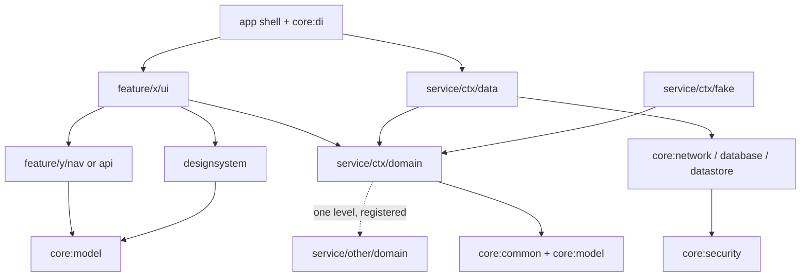

# Architecture

A **Kotlin Multiplatform** architecture for Android and iOS apps that share their business core and choose, per app,
how much of the presentation layer to share. This document describes the architecture only: module tiers, dependency
rules, data flow, testing and enforcement. What a concrete app does and how its features are built is specced
separately in `docs/features/<feature>/`.

The rules are illustrated with a generic **shop** example (section 3) so that they can be judged independently of any
one product.

---

## 1. Goals

- **One business core, two ways to consume it.** The same `core/*` and `service/*` modules back an app inside the
  Kotlin Multiplatform build and standalone native apps that use the core as a published SDK (section 14):

  | App | How it gets the core | Network, local, business logic | ViewModel | UI |
  |---|---|---|---|---|
  | `apps/cmp` | modules of the KMP build | shared | **shared** (KMP ViewModel) | **shared** (Compose Multiplatform) |
  | `native-android/` | published Android libraries (AAR) | shared | Android ViewModel | Jetpack Compose |
  | `native-ios/` (planned) | published XCFramework | shared | Swift `@Observable` | SwiftUI |

- **Scales with the team.** Modules follow the patterns large Android codebases use (Airbnb: feature + nav modules;
  Square: public / impl / fake; Slack: Features / Services / Libraries), so the structure holds as contexts and
  features grow.
- **Rules are checked by the build, not by review.** A forbidden dependency or import fails the build (section 9).
- **Offline-first.** The local database is the single source of truth; the network only refreshes it.
- **Fast feedback.** Almost every test runs on the JVM, without an emulator or Xcode.

---

## 2. Repository layout

Everything lives on `main`, in directories:

```
build-logic/convention/   # tmdb.module (type from path + dependency rules), tmdb.detekt
architecture-test/        # Konsist rules for imports and packages (JVM only)
core/                     # Libraries tier
service/<context>/        # Services tier: domain, data, fake
apps/
└── cmp/                  # Compose Multiplatform app: designsystem, feature/*, app shells
native-android/           # Standalone Gradle project: native Android app on the published core
native-ios/               # Standalone Xcode project: native iOS app on the published core (planned)
docs/
```

- The Kotlin Multiplatform build (root `settings.gradle.kts`) contains the shared core and `apps/cmp` only. It
  never includes or references a `native-*` project.
- `apps/cmp` uses `core/` and `service/` as modules, so a change there is visible to it immediately.
- `native-android/` has its own settings, wrapper, version catalog and Detekt config. It reaches the core only
  through the libraries published to `build/maven-repo` (section 14), so it sees a core change after the core is
  published again.
- `native-*` never depends on `apps/cmp`, and the shared core never depends on an app.
- An app directory is created when its first screen is built.

---

## 3. Worked example: a shop

A small shopping app, chosen because it exercises every rule in this document:

| Tier | Module | Role in the example |
|---|---|---|
| Libraries | `core:model` | `ProductId`, `Money`: used by two contexts and by a `nav` module |
| Services | `service/catalog/{domain,data,fake}` | Products, categories, search. Remote + cached |
| | `service/cart/{domain,data,fake}` | Cart lines. Local only |
| | `service/account/{domain,data}` | Signed-in user, preferences (encrypted settings) |
| | `service/checkout/domain` | Combines cart, catalog and account (see 5.3 rule 4) |
| Features | `feature/product-list/ui` | Browse and search products |
| | `feature/product-details/{nav,ui}` | One product; navigated to from the list |
| | `feature/cart/{api,ui}` | Cart screen; exposes an `AddToCartButton` entry used inside other screens |

How the example uses each rule:

| Rule | In the shop |
|---|---|
| Shared kernel (6.1) | `ProductId` lives in `core:model` because `catalog`, `cart` and `product-details/nav` all need it. `Category` stays in `catalog/domain`. |
| `domain → domain` (5.3) | `cart/domain → catalog/domain`: a cart line shows the current price and stock. `catalog/domain` depends on no other domain, so the chain is one level. |
| Three or more domains | Checkout needs cart, catalog and account, so it gets its own context `service/checkout/domain` instead of a third dependency from `cart`. |
| Use cases (6.2) | `ObserveCart` would only forward, so the ViewModel calls `CartRepository.observe()` directly. `AddToCart` checks stock and quantity limits, so it is a use case. `CalculateCartTotal` applies discounts, so it is a use case. |
| Repository surface (6.2) | `CatalogRepository` exposes `observeProducts`, `refresh`, `search`. `upsertProducts` stays inside `catalog/data`. |
| Offline-first (7) | Product lists are read from the database and refreshed by TTL; the cart is local only and works offline. |
| Feature to feature (5.4) | `PriceTag` (stateless, used by list and details) goes to the design system. The cart badge on the details screen is a `@Composable` slot filled by the app. The `AddToCartButton` deep inside each product-list row comes from `feature/cart/api`. |
| Navigation | `product-list/ui` navigates through `product-details/nav` (`ProductDetailsRoute(productId: ProductId)`), never through `product-details/ui`. |
| Fakes (8) | `FakeCatalogRepository` and `CatalogRepositoryContract` in `catalog/fake`; `CatalogRepositoryImplTest` and `FakeCatalogRepositoryTest` both extend the contract. |

---

## 4. Targets

All shared modules target `androidTarget`, `iosArm64`, `iosSimulatorArm64` and `jvm`.

`jvm` exists mainly for **fast tests** (section 8). `apps/cmp` can also ship a desktop app from it at almost no extra
cost.

---

## 5. Modules

### 5.1 Tiers

| Tier | Directory | Contains |
|---|---|---|
| Libraries | `core/` | Infrastructure and a small shared kernel; no business features |
| Services | `service/<context>/` | One business capability (bounded context): `domain`, `data`, `fake` |
| Features | `apps/<app>/feature/<feature>/` | Screens: `ui` (ViewModel + screen) and, when needed, `nav` / `api` |

`core:di` and each app shell are the **composition roots**: the only modules that see every implementation.

```
core/
├── common/      # AppResult, AppError, DispatcherProvider
├── model/       # Shared kernel: IDs and models used by two or more contexts
├── network/     # HTTP client factory, auth, error mapping (no endpoints)
├── database/    # SQLDelight driver factory (expect/actual), passphrase handling; no tables
├── datastore/   # DataStore KMP with an encrypted serializer
├── security/    # Master key: Android Keystore / iOS Keychain / JVM fake; AES-GCM
├── testing/     # Test dispatchers
└── di/          # initKoin(); collects the Koin module of every service/*/data
service/<context>/
├── domain/      # Models, repository interfaces, use cases
├── data/        # Repository implementations, endpoints + DTOs, mappers, queries, refresh policy, Koin module
└── fake/        # In-memory repository fakes + repository contract tests
```

Layout of one context (shop `catalog`):

```
service/catalog/
├── domain/src/commonMain/kotlin/<root>/service/catalog/domain/
│   ├── model/        Product.kt, Category.kt
│   ├── CatalogRepository.kt
│   └── usecase/      SearchProducts.kt
├── data/src/
│   ├── commonMain/kotlin/<root>/service/catalog/data/
│   │   ├── remote/   CatalogApi.kt, dto/
│   │   ├── local/    CatalogLocalDataSource.kt
│   │   ├── mapper/   ProductMapper.kt
│   │   ├── RefreshPolicy.kt
│   │   ├── CatalogRepositoryImpl.kt
│   │   └── di/CatalogDataModule.kt
│   └── jvmTest/      CatalogRepositoryImplTest.kt (extends the contract), resources/fixtures/*.json
└── fake/src/
    ├── commonMain/kotlin/<root>/service/catalog/fake/
    │   ├── FakeCatalogRepository.kt
    │   └── CatalogRepositoryContract.kt
    └── jvmTest/      FakeCatalogRepositoryTest.kt (extends the contract)
```

Gradle paths, accessors and packages follow the directory: `service/catalog/domain` → `:service:catalog:domain` →
`projects.service.catalog.domain` → package `<root>.service.catalog.domain`, where `<root>` is
`com.banhmilabs.tmdb`. Several modules share a leaf name (`domain`, `data`, `ui`), so the convention plugin gives each
a unique name from its path so Kotlin/Native klibs don't clash.

The **public API of the shared core** is the set of `service/*/domain` modules. Apps never see `data`, `network` or
`database`.

### 5.2 Module types

| Path | Type | Contains |
|---|---|---|
| `core/common`, `core/model` | kernel | Technical primitives; models shared by two or more contexts |
| `core/network`, `core/database`, `core/datastore` | infra | Infrastructure, `expect`/`actual` |
| `core/security` | security | Master key and encryption, used by infra |
| `core/testing` | testing | Shared test utilities |
| `core/di` | root | Wiring of the shared core (`initKoin()`) |
| `apps/<app>/composeApp` | root (app) | `App()`, navigation graph, slots between features; KMP library that also builds the iOS framework |
| `apps/<app>/androidApp` | root (android-app) | Android application: `Application`, `Activity`, Koin start |
| `service/<ctx>/domain` | domain | Context models, repository interfaces, use cases |
| `service/<ctx>/data` | data | Repository implementations, endpoints + DTOs, mappers, queries, Koin module |
| `service/<ctx>/fake` | fake | In-memory repository fakes + the repository contract test |
| `apps/<app>/designsystem` | designsystem | Theme, stateless components used by two or more features, image loading, string resources |
| `…/feature/<x>/nav` | nav | Route, Args, Result only |
| `…/feature/<x>/api` | api | `nav` plus entry interfaces (for example a `@Composable` entry); replaces `nav` when needed |
| `…/feature/<x>/ui` | ui | ViewModel, screen, implementations of the feature's entries |

### 5.3 Dependency rules



Allowed dependencies (everything not listed is forbidden):

| Type | May depend on |
|---|---|
| kernel | nothing |
| infra, security | kernel, `core:security` |
| designsystem | `core:model` |
| domain | kernel, another context's `domain` (one level, see below) |
| data | its own context's `domain`, kernel, infra |
| fake | its own context's `domain`, kernel |
| nav, api | `core:model` |
| ui | its own and other features' `nav` / `api` in the same app, `service/*/domain`, its app's designsystem, kernel |
| testing | kernel |
| root | everything in its app and the shared core |
| test source sets | additionally `service/*/fake`, `core:testing` |

Forbidden in particular: `ui → ui`, `ui → data`, `ui → infra`, `data → data`, `fake → data`, `domain → data` /
`fake`, `fake` outside test source sets (or a demo app), and anything from the shared core to an app.

**`domain → domain`:**

1. Only to another context's `domain`, never to its `data` or `fake`.
2. One level only: a `domain` that another context depends on depends on no other `domain`.
3. Every pair is registered in `DependencyRules.domainAllowlist` with its reason. Current pairs:
   `title → favorites` (home lists carry the favorite flag).
4. When one context would depend on three or more other domains, the combining logic moves to its own context (shop:
   `service/checkout/domain`).

`domain`, `core:model` and `nav` import no frameworks (HTTP client, SQLDelight, Compose, `androidx.`, Koin,
`android.`, `platform.`). `api` may use the Compose runtime for `@Composable` entry interfaces.

### 5.4 When feature A needs something from feature B

Never `ui → ui`. In this order:

1. Data or logic: use `service/*/domain` directly.
2. A stateless component: move it to the app's designsystem.
3. A stateful component owned by B: A's screen takes a `@Composable` slot and the app shell passes B's composable (a
   `@ViewBuilder` closure on SwiftUI).
4. When a slot is not enough (the component sits deep in A's tree): rename B's `nav` to `api`, declare an entry
   interface there, implement it in `B/ui` and bind it with Koin.

Navigation between features goes through the target feature's `nav` module; the app shell builds the navigation
graph.

### 5.5 Creating modules on demand

The target structure is fixed, but a module is created only when it is needed:

| Module | Create when |
|---|---|
| A service context | It has its own repository; until then the capability stays in the nearest context |
| `service/<ctx>/fake` | Tests or a demo of another module need that context's fake repository |
| `feature/<x>/nav` | Another feature navigates to this feature; until then the route lives in `ui` |
| `feature/<x>/api` (rename of `nav`) | The feature must expose an entry component (5.4 rule 4) |
| `apps/<app>/designsystem` | The first stateless component is used by two features |
| An app directory | Its first screen is built |
| A per-feature demo app | Building the full app slows down feature development |

---

## 6. Models and use cases

### 6.1 Where a model lives

A model goes in `core:model` only when **two or more contexts** need it, or a `nav` / `api` module does. Modules of
the same context and features that reach it through a `domain` don't count. Everything else stays in its context's
`domain`. Keep `core:model` small: IDs and value types first, full models only when unavoidable.

### 6.2 Use cases and repositories

- **Use cases are optional.** A ViewModel may call a repository interface directly when it only forwards
  (`observe…`, `refresh…`, `toggle…`). Create a use case only when it:
  1. combines two or more repositories,
  2. applies business rules (filtering, sorting, merging, validation, aggregating refresh errors),
  3. shapes data for a screen that both platforms need, or
  4. is reused by two or more features.

  Reason: in the native apps the ViewModel exists per platform (Kotlin on Android, Swift on iOS), so logic outside
  the core is written twice.
- A use case is a class with `operator fun invoke`, with no interface. Never create a use case that only forwards.
- Repository interfaces expose only what consumers need (`observe`, `refresh`, `toggle`, `set`). Internal operations
  such as `upsert` stay in `data`.
- Time comes from an injected `kotlin.time.Clock`; dispatchers from `DispatcherProvider`.

---

## 7. Data flow (offline-first)

```
UI ◄── ViewModel ◄── (UseCase) ◄── Repository.observe()  ◄── local database (single source of truth)
                                   Repository.refresh() ──► network ──► upsert into the database
```

- **Reads** always come from the database as a `Flow`. The network never feeds the UI directly; data that must be
  fetched on demand (search) is upserted first and then observed.
- **Refresh** is stale-while-revalidate: each cached set stores `fetchedAt`, and a refresh runs when it is older than
  its TTL or the user asks for it. TTLs are set per data type by the context's `RefreshPolicy`.
- **Local-only data** (shop: the cart) has no `refresh` and works fully offline.
- **Errors** map to `AppError` (Network, Unauthorized, NotFound, Unknown) inside `AppResult`. An error never clears
  cached data.
- **Locale-dependent content** is cached per locale; the cache key includes the locale.
- **Connectivity** is observed per platform behind an `expect`/`actual` interface; the UI keeps showing cached
  content while offline.
- **Schema ownership:** each context's `data` module owns its own SQLDelight database (its `.sq` files and database
  file); `core:database` provides only the driver factory. A context reads another context's data through that
  context's `domain`, never through a SQL join, so `data → data` stays impossible even at the schema level.

---

## 8. Testing strategy

| Level | Tools | Source set |
|---|---|---|
| Domain and data unit tests | `kotlin.test`, Turbine, Kotest assertions, service fakes, MockK | `jvmTest` (default) |
| Pure multiplatform logic that should also run on Kotlin/Native | `kotlin.test`, Turbine, Kotest assertions, service fakes (no MockK) | `commonTest` (allowed) |
| Network | HTTP client mock engine + fixture JSON (each `data` module's test resources) | `jvmTest` |
| Database | SQLDelight in-memory driver, real database, not mocked | `jvmTest` |
| Platform code (`actual`) | Android: instrumented tests. iOS: `kotlin.test`, no mocks | device / simulator, local |
| Repository fakes | Contract test shared by `data` and `fake` | `jvmTest` |
| Shared ViewModels (`apps/cmp`) | `kotlinx-coroutines-test`, Turbine, service fakes, MockK | `jvmTest` |
| Compose UI and screenshots (`apps/cmp`) | `runComposeUiTest` from `androidx.compose.ui.test.v2` (the v1 one is deprecated), Roborazzi | JVM |
| Native Android (`native-android/`) | JUnit 4 + MockK ViewModel tests against the published domain API; UI checked manually on device | JVM, run locally |
| Native iOS (`native-ios/`, planned) | XCTest for Swift ViewModels; XCUITest for flows | simulator |
| Architecture | Konsist | JVM |
| Coverage and static analysis | Kover (80% line on `domain` and `data`), Detekt | CI |

Rules:

- **`jvmTest` is the default** for unit tests: fast, and it can use MockK and JVM-only tooling.
- **`commonTest` is allowed** for tests that use only multiplatform libraries (no MockK) and are worth running on
  Kotlin/Native too: concurrency and `Flow` timing, formatting, parsing, date and time. `commonTest` tests also run in
  the `jvmTest` task, so they cost nothing on CI and can be run on the iOS simulator locally.
- **Test doubles across modules are the service fakes.** Each `service/<ctx>/fake` holds an in-memory, controllable
  fake per repository interface. ViewModel and use case tests run the real use cases on top of a fake repository.
- **Fakes are kept honest by contract tests.** An abstract `<Repository>Contract` in the `fake` module describes the
  behavior; both `<Repository>ImplTest` (in `data`) and `Fake<Repository>Test` (in `fake`) extend it.
- **MockK** is for collaborators inside the same module and for verifying interactions, in `jvmTest` only. No other
  hand-written fakes, no Mokkery.
- The HTTP mock engine and the in-memory database driver are test engines, not fakes; the database and HTTP client
  are never mocked.
- **Platform code is tested on its platform**, locally: Android `actual` code with instrumented tests, iOS `actual`
  code on the simulator with `kotlin.test`. Never MockK there.

---

## 9. Enforcement

| Rule | Checked by |
|---|---|
| Module type from path; unknown paths rejected | `tmdb.module` (`moduleTypeOf` in `build-logic`) |
| Allowed dependencies (5.3 table), the `domain → domain` allowlist and its one-level depth | `tmdb.module` (`DependencyRules`): a forbidden `project(...)` dependency fails configuration with `Rule: <from> -> <to>: …` |
| No framework imports; package matches the path; import rules | Konsist (`architecture-test`) |
| Unique module names per path | `tmdb.module` sets `group` from the path |

Every shared module applies only `alias(libs.plugins.tmdb.module)`; KMP targets, Detekt and (for `domain` / `data`)
Kover come from its type. The rule table and type parsing have unit tests in `build-logic`.

Module paths recognised by `moduleTypeOf`: `:core:<name>`, `:service:<ctx>:domain|data|fake`,
`:apps:<app>:designsystem`, `:apps:<app>:composeApp`, `:apps:<app>:androidApp` and
`:apps:<app>:feature:<x>:nav|api|ui`. The shared core (`core/`, `service/`) never depends on an app.

`tmdb.module` configures `apps/cmp`: `composeApp` as a KMP library with the iOS framework, `androidApp` as an Android
application, and Compose Multiplatform on its `designsystem`, `ui` and `composeApp` modules.

The standalone `native-*` projects are outside the KMP build, so neither `tmdb.module` nor Konsist checks them. Their
boundary is the published API: they compile only against what the core publishes. Each runs its own Detekt and unit
tests.

---

## 10. Security

- **Secrets** (API tokens) never live in source or committed files: a git-ignored `secrets.properties` locally,
  CI secrets on CI. At build time they are injected obfuscated (XOR with a per-build salt), never as a plaintext
  string. Any key shipped in a client can still be extracted; the real fix is a backend proxy that keeps it
  server-side.
- **Network hardening:** HTTPS only, no request or response body logging in release builds. Certificate pinning only
  for hosts the project controls, or against CA keys with backup pins; pinning a third-party leaf certificate breaks
  the app when that party rotates it.
- **Encrypted settings:** `core:security` provides AES-256-GCM with a per-device master key: on Android a
  non-exportable Android Keystore key used through `javax.crypto` (the key never leaves the Keystore); on iOS a key in
  the Keychain with `kSecAttrAccessibleAfterFirstUnlockThisDeviceOnly` and on JVM (tests) an in-memory key, both
  through `cryptography-kotlin`. `core:datastore` stores `@Serializable` values as JSON encrypted with it. If the key is
  lost (backup restore, device reset), decryption fails and the store is reset to defaults instead of crashing. `EncryptedSharedPreferences` is not used (deprecated).
- **Database encryption (planned):** the database is plain SQLDelight for now. `DatabaseDriverFactory.create(passphrase:
  ByteArray?)` already takes a passphrase so SQLCipher can be added without changing the architecture.

---

## 11. Presentation per app

### `apps/cmp`: share everything

```
apps/cmp/
├── designsystem/         # Theme, typography, stateless components, image loading, Compose resources
├── feature/<x>/{nav,api,ui}/
├── composeApp/           # App(), type-safe navigation graph, slots between features, MainViewController()
├── androidApp/           # Activity, Application
├── iosApp/               # Hosts ComposeUIViewController only
└── desktopApp/           # optional
```

ViewModels use androidx.lifecycle KMP and follow MVI:

- **State**: an immutable `data class <Feature>UiState`, exposed as `StateFlow` (`state`).
- **Intent**: a `sealed interface <Feature>Intent` of user actions, handled by a single `fun onIntent(intent)`.
- **Effect**: a `sealed interface <Feature>Effect` of one-off events such as navigation, exposed as a `Flow` (`effects`)
  backed by a buffered `Channel`.

The stateful `<Feature>Screen(callbacks, viewModel = koinViewModel())` collects `state` and `effects` and turns
effects into callbacks for the app shell. It draws the stateless `<Feature>Content(state, onIntent)`, which UI tests
and previews use without Koin. The navigation entry only declares the destination and calls `<Feature>Screen`. There is no shared MVI base class until a second
feature needs one. Reference: `apps/cmp/feature/onboarding/ui`.

Packages inside a feature `ui` module are organized by screen, not by layer; the module is already the feature and
layer boundary. Only `navigation/` and `di/` are fixed packages:

```
feature/<x>/ui/src/commonMain/kotlin/<root>/apps/cmp/feature/<x>/ui/
├── navigation/                   <X>Route, NavGraphBuilder.<x>Screen(callbacks)   (public API for the app shell)
├── di/                           Koin module (public)
├── <X>Contract.kt                <X>UiState, <X>Intent, <X>Effect
├── <X>ViewModel.kt
├── <X>Screen.kt                  <X>Screen (stateful) + <X>Content (stateless); design values private here
└── component/                    composables and helpers used only by this feature
```

A feature with two or more screens gets one package per screen (`list/`, `detail/`), each with its own contract,
ViewModel, screen and `component/`. Tests mirror the packages.

### `native-android/`: standalone Android app

```
native-android/
├── settings.gradle.kts   # repositories: build/maven-repo (group com.banhmilabs.tmdb only), google, mavenCentral
├── gradle/libs.versions.toml, gradlew, config/detekt/
└── app/                  # Application (initKoin), Activity, NavHost, screens; theme in the designsystem package
```

- One `:app` module to start; designsystem and feature modules are split out when a second feature needs them.
- Dependencies are the published root coordinates `com.banhmilabs.tmdb:core-di` (Koin start-up, brings the data
  layer at runtime) and `com.banhmilabs.tmdb:service-<ctx>-domain` (repository interfaces, use cases, models).
  Gradle metadata selects the Android variant.
- ViewModels and UI are Android-only (Android ViewModel, Jetpack Compose). The feature rules are the same as in
  `apps/cmp`: a screen reads repositories through `domain`, never through `data`.
- Workflow: `./gradlew publishSharedCore` at the root, then build in `native-android/` (its `README.md`).

### `native-ios/` (planned)

A standalone Xcode project that consumes an XCFramework published by the KMP build, the same way `native-android/`
consumes AARs. It links exactly one Kotlin umbrella framework (to avoid duplicating the Kotlin runtime and types),
which exports `core:common`, `core:model` and the `service/*/domain` modules. SKIE turns `Flow<T>` into
`AsyncSequence`, `suspend` into `async throws` and `sealed` hierarchies into exhaustive `switch`. The details are
specced when the app is built.

### Localization

| Layer | Strings |
|---|---|
| Remote content | Locale sent to the API, cached per locale |
| `apps/cmp` UI | Compose Multiplatform resources |
| `native-android/` UI | Android resources |
| `native-ios/` UI (planned) | String Catalog |

---

## 12. Tech stack

| Area | Choice |
|---|---|
| Language | Kotlin 2.x (K2), Swift 6 |
| UI | Compose Multiplatform (`apps/cmp`); Jetpack Compose (`native-android/`); SwiftUI (`native-ios/`, planned) |
| Navigation | Navigation Compose (type-safe); SwiftUI `NavigationStack` |
| DI | Koin |
| Networking | Ktor Client, kotlinx.serialization |
| Database | SQLDelight (SQLCipher planned) |
| Settings | DataStore KMP + AES-GCM (Android Keystore; `cryptography-kotlin` on iOS / JVM) |
| Images | Coil 3 (Compose); a disk-caching image library on SwiftUI |
| iOS interop | SKIE (planned, with `native-ios/`) |
| Testing | `kotlin.test`, MockK, Turbine, Kotest assertions; Konsist; Kover |
| Build | Gradle version catalog, convention plugins in `build-logic` |

---

## 13. CI

CI runs on `main` and on pull requests to it, on Ubuntu, JVM only, for the KMP build:

```bash
./gradlew detekt jvmTest koverVerify :architecture-test:test
```

Android and iOS targets, the app builds and platform tests run locally:

```bash
# Compile every target (needs macOS + Xcode)
./gradlew assemble
```

The standalone `native-android/` is not built on CI. It is built and checked locally:

```bash
./gradlew publishSharedCore
cd native-android && ./gradlew :app:assembleDebug :app:detekt :app:testDebugUnitTest
```

---

## 14. Publishing the shared core

The KMP build publishes the shared core so that standalone apps can use it like any SDK.

- **What:** every production module of `core/` and `service/` that has code. Never `service/*/fake`, `core:testing`
  or app modules. Each module publishes all its Kotlin Multiplatform publications: the root Gradle metadata module,
  Android (AAR), JVM and the iOS klibs (macOS + Xcode).
- **Coordinates:** `com.banhmilabs.tmdb:<path-with-dashes>:0.1.0-SNAPSHOT`, for example `core-di` and
  `service-settings-domain`, with the platform suffixes `-android`, `-jvm` and `-iosarm64`. The POM and Gradle
  metadata name inter-module dependencies with the same coordinates, so a consumer declares only what it uses.
- **Where:** the git-ignored Maven repository `build/maven-repo` at the repo root, written by
  `./gradlew publishSharedCore`. Publishing again at the same SNAPSHOT version replaces the artifacts.
- **Consumer:** declares `maven("../build/maven-repo")` restricted to the group `com.banhmilabs.tmdb`, and excludes
  that group from the remote repositories. A build before publishing then fails with a clear "Could not find
  com.banhmilabs.tmdb:…". It depends on the root coordinates; Gradle metadata picks the platform variant.
- Set up by `tmdb.module` (`build-logic/.../buildlogic/Publishing.kt`).
