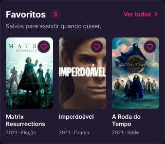
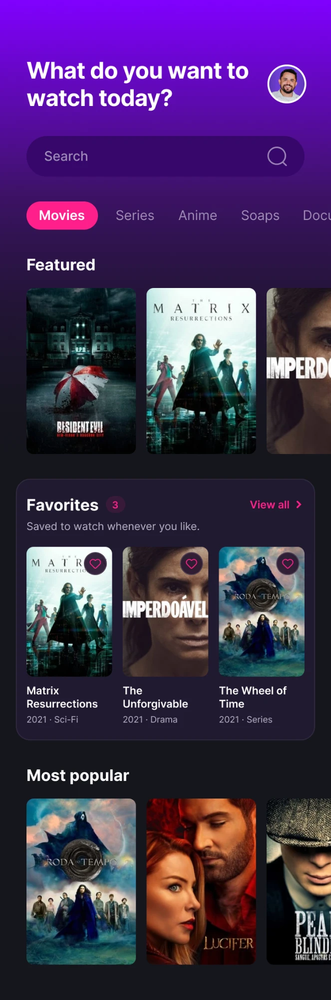

# Home – Favorites section

Feature: [task.md](../task.md)
Source: screenshots: `home-favorites.png` (pt-BR, 1×, Figma frame
[341:483](https://www.figma.com/design/G4YiZkobsY5gJP94z8pFlh/TMDB--Community-?node-id=341-483)),
`home-favorites-in-home-en.webp` (en, whole Home, ≈1.77×). The Figma MCP was rate-limited, so every size is an
estimate measured on the screenshots; colors are sampled pixels.
Status: Confirmed

## Reference

In context (en): 

## Layout
The section is a card on Home, between the featured row and the "Most popular" / "Mais populares" heading
(task.md AC-1). The rest of Home is unchanged (`docs/features/home/design/home.md`).

- Card: ≈339×293dp, ≈18dp from each screen edge, so it sits ≈12dp outside Home's 30dp content padding.
- Gap from the featured posters' bottom to the card top ≈28dp; from the card bottom to the "Most popular" heading
  ≈32dp.
- Inside the card (padding ≈12dp start, so posters line up with Home's 30dp content edge), top to bottom:
  1. Header row (top ≈18dp): "Favoritos" title, count badge ≈8dp after it; "Ver todos ›" aligned to the end (≈16dp
     from the card's end edge).
     At large text sizes, when the row doesn't fit, "Ver todos ›" moves to its own line below the title and badge,
     at the end edge, kept on one line with its chevron (`native-ios`: `ViewThatFits` in `FavoritesSection`).
  2. Subtitle, ≈12dp below the title.
  3. Poster row, ≈16dp below the subtitle: horizontal scroll of up to 10 items, ≈12dp apart. It scrolls inside the
     card; the third item ends ≈12dp from the card's end edge in the design.
  4. ≈14dp bottom padding below the last text line.

## Components
| Component | Values |
|---|---|
| Card | ≈339×293dp, radius ≈16dp, fill `#211A30`, 1dp border ≈`#312A3F` |
| Title "Favoritos" | white `#FFFFFF`, bold, ≈20sp (cap height ≈14dp) |
| Count badge | circle ≈22dp, fill ≈`#381A39` (pink on the card at low opacity), number `#FF1F8A` bold ≈12sp, centered |
| "Ver todos" link | `#FF1F8A`, semibold ≈14sp, followed by a chevron "›" ≈12dp in `#FF1F8A`, ≈6dp gap |
| Subtitle | gray ≈`#A6A1B5`, regular ≈13sp |
| Poster | ≈97×147dp (2:3), radius ≈8dp, image cropped to fill |
| Poster placeholder (from user) | Same as Home's poster placeholder (`home/design/home.md`): fill `#36076B`, title name Inter SemiBold 14sp `#FFFFFF`, centered, padding 8dp, up to 4 lines, ellipsis; sized ≈97×147dp, radius ≈8dp; heart button on top as usual |
| Heart button | circle ≈28dp, ≈6dp from the poster's top and end edges, fill ≈`#34263C` at high opacity; outline heart ≈14dp, `#FF1F8A`, centered |
| Name | white, semibold ≈14sp, line height ≈16sp, up to 2 lines, ellipsis; ≈12dp below the poster; width of the poster |
| Meta line "2021 · Ficção" | gray ≈`#A6A1B5`, regular ≈12sp; ≈8dp below the name; "year · first genre" with a middle dot and single spaces |

## Copy
| Where | pt-BR | en |
|---|---|---|
| Title | Favoritos | Favorites |
| Subtitle | Salvos para assistir quando quiser. | Saved to watch whenever you like. |
| Link | Ver todos | View all |
| Badge | total number of favorites, e.g. "3" | same |
| Meta line | `<year> · <first genre>`, e.g. "2021 · Ficção" | e.g. "2021 · Sci-Fi" |
| Heart, screen reader | Remover dos favoritos | Remove from favorites |

## States
### Content
As in the reference: up to 10 favorites, most recently added first; the badge shows the total (task.md AC-1, EC-4).

### Hidden
No favorites: the card is not drawn and the featured row is followed directly by "Mais populares", with Home's
usual spacing (task.md AC-2).

## Dark mode
The design is dark only. No light variant.

## Interactions
| Element | Action | Result | AC |
|---|---|---|---|
| Item (poster, name or meta line) | Tap | Opens the title's details; exactly once on repeated taps | AC-5, EC-2 |
| Heart button | Tap | Opens the confirmation popup ([remove-favorite-dialog](remove-favorite-dialog.md)) | AC-6, EC-1 |
| "Ver todos" (link and chevron) | Tap | Opens [My favorites](my-favorites.md); exactly once on repeated taps | AC-3, EC-2 |
| Poster row | Horizontal scroll | Scrolls the items inside the card | AC-1 |
| Item | Screen reader | Button with the title's name; heart as a "Remove from favorites" button | AC-13 |

## Assets
| File | Original format | Size | Used in | Status |
|---|---|---|---|---|
| Outline heart | — | ≈14×14 | Heart button | missing: Figma MCP rate-limited |
| Chevron right | — | ≈12×12 | "Ver todos" link | missing: Figma MCP rate-limited |

Posters are TMDB images loaded at runtime, not assets.

## Tokens
Design-system tokens the screen uses in all three apps (`docs/features/design-system/`). Measurements above
stay as the Figma record.

| Element | Spacing | Text | Shape | Color |
|---|---|---|---|---|
| Card | `xxl` − `sm` from the screen edge; `xxl` above; `lg` top, `md` bottom, `sm` sides | — | `large` | `surfaceContainer`, `surfaceContainerHigh` border (`borderWidth`) | |
| Title | — | `titleLarge` | — | `onSurface` | |
| Count badge | `xs` after the title; `xs` padding; min size 24 | `labelMedium` | full (circle) | `secondaryContainer` / `onSecondaryContainer` | |
| View all | `xs` padding and chevron gap; chevron 12 | `labelLarge` | — | `secondary` | |
| Subtitle | `sm` below the header | `bodyMedium` | — | `onSurfaceVariant` | |
| Items | `md` below the subtitle; `sm` between items; 96 wide, 148 poster | name `titleSmall` (2 lines), meta `bodySmall` | poster `small` | name `onSurface`, meta `onSurfaceVariant` | |
| Heart | `xxs` from the poster's top and end | — | full (circle) | `FavoriteHeart` (filled `secondary` on `surfaceContainerHigh` 65%) | |

## Gaps
- [ ] Exact sizes, font names, radii and the heart and chevron assets: re-read Figma frame 341:483 once the MCP
  limit resets.
- [ ] Badge with two or more digits (e.g. "12"): the design shows only a one-digit circle (task.md EC-4).

## Change log
- 2026-11-23: Initial version, from screenshots (Figma MCP rate-limited).
- 2026-11-23: Confirmed by the user.
- 2026-11-24: Added Tokens (design system).
