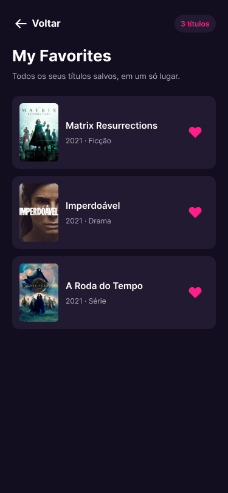
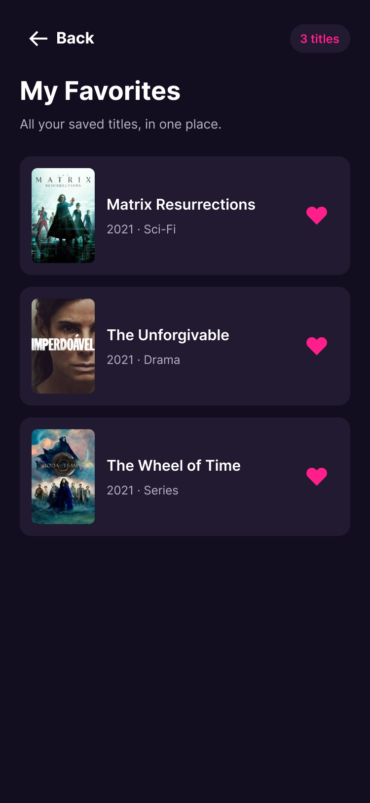

# My favorites

Feature: [task.md](../task.md)
Source: screenshots: `my-favorites.png` (pt-BR, 1×, 375×812, Figma frame
[396:2](https://www.figma.com/design/G4YiZkobsY5gJP94z8pFlh/TMDB--Community-?node-id=396-2)),
`my-favorites-en.png` (en, 2×). The Figma MCP was rate-limited, so every size is an estimate measured on the
screenshots; colors are sampled pixels.
Status: Confirmed

## Reference

English: 

## Layout
Frame 375×812dp, background solid `#130E1F`. Side padding ≈20dp. Top to bottom:

| Element | Position (x, y) | Size | Gap to next |
|---|---|---|---|
| Back control (arrow + "Voltar") | arrow ≈25, 31; label after the arrow, ≈8dp gap | arrow ≈20×16, label ≈16sp | — |
| Count badge "3 títulos" (end aligned) | ≈287, 25 | ≈68×28 | — |
| Title "My Favorites" | ≈20, 81 | cap height ≈25 | ≈13dp (→ subtitle 119) |
| Subtitle | ≈20, 119 | ≈14 high | ≈26dp (→ first card 158) |
| Favorite card | ≈20, 158 | ≈335×120 | ≈12dp between cards |

### Scrolling (from task.md)
The list scrolls vertically; whether the header scrolls with it is not shown (see Gaps). There is no pull-to-refresh.

## Components
| Component | Values |
|---|---|
| Back arrow | ≈20×16dp, white `#FFFFFF`; same arrow as Title details (`title-details/design/assets/ic_back_arrow.svg`) |
| "Voltar" label | white, bold ≈16sp |
| Count badge | pill ≈68×28dp, radius ≈14dp (fully round), fill `#211A30`; text `#FF1F8A`, bold ≈12sp, padding ≈12dp horizontal |
| Title | "My Favorites", white, bold ≈26sp |
| Subtitle | gray ≈`#A6A1B5`, regular ≈13sp |
| Favorite card | ≈335×120dp, radius ≈12dp, fill `#211A30`, padding ≈12dp |
| Card poster | ≈64×96dp (2:3), radius ≈6dp, image cropped to fill, vertically centered |
| Card poster placeholder (from user) | Home's poster placeholder (`home/design/home.md`): fill `#36076B`, title name Inter SemiBold 14sp `#FFFFFF`, centered, padding 8dp, ellipsis; sized ≈64×96dp, radius ≈6dp |
| Card name | white, semibold ≈16sp, ≈14dp after the poster, 1 line in the design (see Gaps) |
| Card meta line | gray ≈`#A6A1B5`, regular ≈13sp, ≈8dp below the name; "year · first genre" |
| Name + meta block | vertically centered in the card |
| Card heart | filled heart ≈20×18dp, `#FF1F8A`, vertically centered, ≈24dp from the card's end edge; touch target at least 48dp |
| Empty message (from user) | gray ≈`#A6A1B5`, regular ≈14sp, centered, in place of the list |

## Copy
| Where | pt-BR | en |
|---|---|---|
| Back | Voltar | Back |
| Badge | `<n> títulos`; "1 título" for one; "0 títulos" when empty | `<n> titles`; "1 title"; "0 titles" |
| Title | My Favorites (as in the pt-BR design) | My Favorites |
| Subtitle | Todos os seus títulos salvos, em um só lugar. | All your saved titles, in one place. |
| Meta line | e.g. "2021 · Ficção" | e.g. "2021 · Sci-Fi" |
| Empty message (from user) | Nenhum favorito ainda. Toque no coração de um título para salvá-lo aqui. | No favorites yet. Tap the heart on a title to save it here. |
| Heart, screen reader | Remover dos favoritos | Remove from favorites |

## States
### Content
As in the reference: every favorite, most recently added first (task.md AC-3).

### Empty (from user)
Back, badge "0 títulos" / "0 titles", title and subtitle stay as in Content. The list is replaced by the empty
message, horizontally centered, in the middle of the space below the subtitle (task.md AC-10).

### Remove popup open
The [remove-favorite-dialog](remove-favorite-dialog.md) over this screen, with the scrim. The header keeps "Voltar"
(from user: the frame without the label is a design slip).

## Dark mode
The design is dark only. No light variant.

## Interactions
| Element | Action | Result | AC |
|---|---|---|---|
| Back control / system back | Tap | Returns to Home as it was | AC-3 |
| Card (anywhere except the heart) | Tap | Opens the title's details; exactly once on repeated taps | AC-5, EC-2 |
| Card heart | Tap | Opens the confirmation popup | AC-6, EC-1 |
| "Remover" in the popup | Tap | The card disappears and the badge shows the new total; the last one leads to Empty | AC-8, AC-10 |
| Card | Screen reader | Button with the title's name; heart as a "Remove from favorites" button | AC-13 |

## Assets
| File | Original format | Size | Used in | Status |
|---|---|---|---|---|
| Back arrow | SVG | 24×24 | Back control | missing here: Figma MCP rate-limited; the same arrow is in `../../title-details/design/assets/ic_back_arrow.svg` |
| Filled heart | — | ≈20×18 | Card heart | missing: Figma MCP rate-limited |

Posters are TMDB images loaded at runtime, not assets.

## Gaps
- [ ] Exact sizes, font names, radii and the assets: re-read Figma frame 396:2 once the MCP limit resets.
- [ ] Whether the header (Back, badge, title, subtitle) scrolls with the list or stays fixed.
- [ ] Long names in a card: wrap to two lines or truncate on one (task.md EC-5 says truncated; line count not
  designed).
- [ ] Title copy in pt-BR: the pt-BR design keeps "My Favorites" in English; confirm or give "Meus favoritos".

## Change log
- 2026-11-23: Initial version, from screenshots (Figma MCP rate-limited).
- 2026-11-23: Confirmed by the user.
