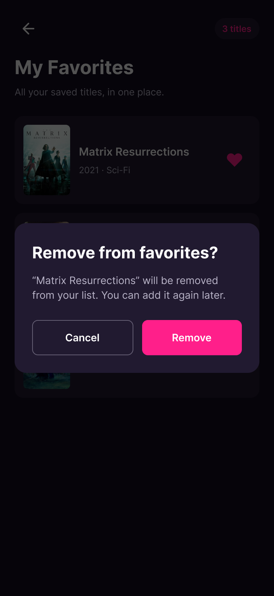

# Remove favorite dialog

Feature: [task.md](../task.md)
Source: screenshots: `remove-favorite-dialog.png` (pt-BR, 1×, 335×224, Figma frame
[398:50](https://www.figma.com/design/G4YiZkobsY5gJP94z8pFlh/TMDB--Community-?node-id=398-50)),
`remove-favorite-dialog-in-context-en.png` (en, 2×, over My favorites). The Figma MCP was rate-limited, so every
size is an estimate measured on the screenshots; colors are sampled pixels.
Status: Confirmed

Shown on Home (Favorites section), [My favorites](my-favorites.md) and Title details (task.md AC-6, AC-7). The same
dialog is used on all three.

## Reference

In context (en): 

## Layout
- Scrim over the whole screen: black at ≈68% opacity (`#130E1F` under it reads ≈`#06040A`).
- Dialog: ≈335dp wide (≈20dp from each screen edge on a 375dp screen), height fits the content (≈216dp in the
  design), vertically centered on the screen.
- Inside, padding ≈24dp start/end/top, ≈20dp bottom. Top to bottom:
  1. Title, top ≈24dp.
  2. Message, ≈20dp below the title; wraps (three lines in the pt-BR design, two in en).
  3. Button row, ≈24dp below the message: "Cancelar" and "Remover" side by side, equal width (≈138dp each),
     ≈12dp apart.

## Components
| Component | Values |
|---|---|
| Dialog | radius ≈20dp, fill `#211A30`, no border |
| Title | white `#FFFFFF`, bold ≈22sp |
| Message | gray ≈`#B0AABF`, regular ≈14sp, line height ≈20sp; the title name in curly double quotes “…” |
| "Cancelar" button | ≈138×48dp, radius ≈10dp, transparent fill, 1dp border ≈`#655F74`; label white, semibold ≈16sp, centered |
| "Remover" button | ≈138×48dp, radius ≈10dp, fill `#FF1F8A`; label white, semibold ≈16sp, centered |

## Copy
| Where | pt-BR | en |
|---|---|---|
| Title | Remover dos favoritos? | Remove from favorites? |
| Message | “`<name>`” será removido da sua lista. Você pode adicioná-lo novamente depois. | “`<name>`” will be removed from your list. You can add it again later. |
| Cancel | Cancelar | Cancel |
| Confirm | Remover | Remove |

## States
### Shown
As in the reference. The name is the title's name in the current language; a long name wraps and is shown in full
(task.md EC-5).

## Dark mode
The design is dark only. No light variant.

## Interactions
| Element | Action | Result | AC |
|---|---|---|---|
| "Remover" | Tap | Closes the dialog and removes the favorite; only once on repeated taps | AC-8, EC-1 |
| "Cancelar" | Tap | Closes the dialog; nothing changes | AC-9 |
| Scrim (outside the dialog) | Tap | Closes the dialog; nothing changes | AC-9 |
| System back | Press | Closes the dialog; nothing changes | AC-9 |
| Dialog | Screen reader | Takes focus while open; title read first, then message and buttons | AC-13 |

## Assets
None.

## Tokens
Design-system tokens the screen uses in all three apps (`docs/features/design-system/`). Measurements above
stay as the Figma record.

| Element | Spacing | Text | Shape | Color |
|---|---|---|---|---|
| Dialog | `lg` from the screen edge; `xl` top and sides, `lg` bottom | — | `extraLarge` | `surfaceContainer`; scrim `scrim` | |
| Title | `lg` below | `titleLarge` | — | `onSurface` | |
| Message | `xl` below | `bodyMedium` | — | `onSurfaceVariant` | |
| Buttons | `sm` between; min height `touchTarget` | `titleMedium` | `medium` | cancel `outline` border (`borderWidth`) and `onSurface`; confirm `secondary` / `onSecondary` | |

## Gaps
- [ ] Exact sizes, font names and radii: re-read Figma frame 398:50 once the MCP limit resets.
- [ ] Open/close animation: not designed.

## Change log
- 2026-11-23: Initial version, from screenshots (Figma MCP rate-limited).
- 2026-11-23: Confirmed by the user.
- 2026-11-24: Added Tokens (design system).
