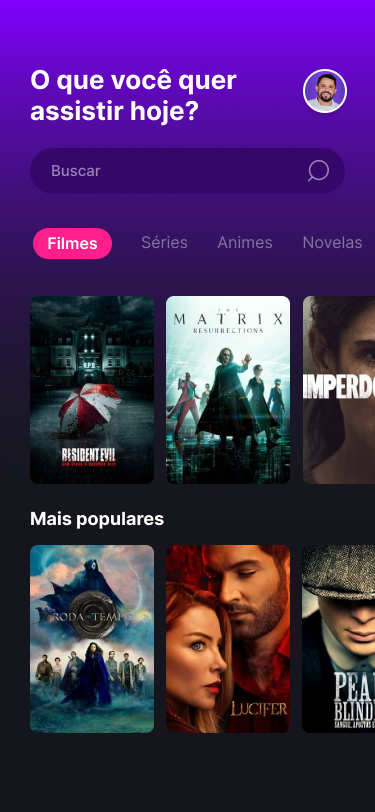

# Home

Feature: [task.md](../task.md)
Source: [Figma frame "Home" (node 29:2)](https://www.figma.com/design/G4YiZkobsY5gJP94z8pFlh/TMDB--Community-?node-id=29-2)
Status: Confirmed

## Reference

## Layout
Frame 375×812dp. Positions below are from the frame's top-left corner.

Background, back to front:
1. **Screen background** (frame fill): vertical linear gradient, `#303243` at 0% → `#15151D` at 65.394%,
   solid `#15151D` below.
2. **Header glow** (`Rectangle 10`): 375×522dp at the top, vertical linear gradient `#8000FF` at 0% →
   transparent at 100%. It sits behind the title, search, tabs and most of the featured row.

Content, top to bottom (start padding 30dp throughout):

| Element | Position (x, y) | Size | Gap to next |
|---|---|---|---|
| Title + avatar row | title 30, 64; avatar 305, 71 | title 288×67; avatar 40×40 | 17dp (title bottom 131 → search 148) |
| Search field | 30, 148 | 315×46 | 31dp (→ tabs 225) |
| Category tabs | 30, 225 | 34 high | 37dp (tabs bottom 259 → featured row 296) |
| Featured row | 30, 296 | 188 high | 23dp (→ "Mais populares" heading 507) |
| "Mais populares" heading | 30, 507 | 135×22 | 16dp (heading bottom 529 → row 545) |
| Popular row | 30, 545 | 188 high | 79dp to the frame bottom (812) |

- The title is start-aligned; the avatar's top is 7dp below the title's top, and its right edge is 30dp from the
  screen edge.
- The featured row has no heading in the design.

### Scrolling and adaptive layout (from user)
- The whole screen scrolls vertically, the header included (no sticky header). Pull-to-refresh is on this
  vertical scroll (AC-9).
- Tabs and both poster rows scroll horizontally. They start at the 30dp padding and bleed to the right screen
  edge (content scrolls under the edge; no end clipping at 345dp).
- Larger screens, landscape and large fonts: the same single column; rows show more posters; the title wraps
  (EC-10).

### System bars (from user)
Edge-to-edge, as in onboarding: the background and header glow draw behind the status bar, with light (white)
status bar icons. The title's 64dp top offset is measured from the top of the frame; keep the content clear of
the status bar inset.

## Components
| Component | Values |
|---|---|
| Title (`29:4`) | Inter Bold 26sp, line height normal, `#FFFFFF`, start-aligned, width 288dp, 2 lines in the design |
| Avatar (`Ellipse 1`) | Design: 40×40dp circle with a person photo and a drop shadow (the exported image spans −20%/−10%/−20%/−30% around the circle, i.e. 56×56dp). **App (from user):** 40dp circle, fill `#36076B`, white person icon at 50% opacity, no shadow. Decorative. |
| Search field (`Rectangle 1`) | 315×46dp, corner radius 32dp (pill), fill `#36076B` |
| Search hint (`29:15`) | "Buscar", Inter Medium 15sp, line height normal, `#FFFFFF` at 50% opacity; x 51 (21dp inside the field), y 162 (vertically centered in the field) |
| Search icon (`Iconly/Light-Outline/Search`) | 20.97×21.44dp, `#FFFFFF` at 50% opacity (baked into the SVG), mirrored horizontally (the handle points down-left); left edge at x ≈ 308 (16dp from the field's right edge), y 160–181.5 (vertically centered) → `assets/iconly_light_outline_search.svg` (as exported, not mirrored) |
| Selected tab (`Frame 14`) | Pill, corner radius 70dp, fill `#FF1F8A`, padding 14dp horizontal / 6dp vertical, height 31dp; label Inter SemiBold 16sp, line height normal, `#FFFFFF`, centered. Starts 3dp inside the tabs row (x 33, y 228) |
| Unselected tab | Label only (no fill): Inter Regular 16sp, line height normal, `#FFFFFF` at 40% opacity, centered; text top 8dp below the row top |
| Tab spacing | 29dp from the end of one tab to the start of the next label (the selected pill's edge counts as its end). Labels in the design: Filmes (pill 79dp wide), Séries 47dp, Animes 56dp, Novelas 61dp, Documentários 115dp |
| Poster | 124×188dp, corner radius 8dp, image cropped to fill (cover) |
| Featured row | Posters 124dp wide; gaps 12–16dp in the design, **12dp in the app (from user)** |
| Popular row | Posters 124dp wide, 12dp gap (136dp step) |
| Section heading (`29:6`) | "Mais populares", Inter Bold 18sp, line height normal, `#FFFFFF`, single line |
| Poster placeholder (from user) | 124×188dp, radius 8dp, fill `#36076B`; title name Inter SemiBold 14sp `#FFFFFF`, centered, padding 8dp, up to 4 lines, ellipsis (AC-11, EC-2) |

No Figma variables or styles are bound to this frame; all values are raw.

## Copy
| Where | Text |
|---|---|
| Title (pt-BR) | O que você quer assistir hoje? |
| Title (en) | What do you want to watch today? (from task.md AC-10) |
| Search hint (pt-BR / en) | Buscar / Search |
| Tabs (pt-BR) | Filmes · Séries · Animes · Novelas · Documentários |
| Tabs (en) | Movies · Series · Anime · Telenovelas · Documentaries (from user, plan 04) |
| Section heading (pt-BR / en) | Mais populares / Most popular |
| Retry button (pt-BR) | Tentar novamente |
| Empty row (en / pt-BR) | Nothing to show here yet. / Nada para mostrar aqui ainda. (from user, plan 05) |
| Error row (en / pt-BR) | Couldn't load these titles. / Não foi possível carregar estes títulos. (from user, plan 05) |
| Retry button (en) | Try again (from user, plan 05) |

## States
### Content
As in the reference: header, search, tabs (Filmes selected), featured row, "Mais populares" heading and row.

### Loading (from user)
Nothing cached for the selected category: header, search and tabs as in Content; below the tabs, in place of
both rows and the heading, a circular indeterminate spinner in `#FF1F8A`, centered horizontally in the content
area (AC-6).

### Refreshing
Content stays visible; during pull-to-refresh the platform's pull-to-refresh indicator shows at the top (AC-9).
Not designed.

### Empty (from user)
Per row (EC-3): the row keeps its 188dp height; in place of the posters, a message in Inter Regular 15sp
`#FFFFFF` at 50% opacity, start-aligned at the 30dp padding, vertically centered. The "Mais populares" heading
stays.

### Error (from user)
Per row with no cache (AC-8, EC-4): as Empty, with the error message and below it a "Tentar novamente" pill in
the selected-tab style (fill `#FF1F8A`, radius 70dp, padding 14dp / 6dp, Inter SemiBold 16sp `#FFFFFF`).

## Large text
Poster placeholder names (and every title name on Home) never break inside a word. When a name reaches its line limit, or one word is wider than its line, the
text stops at the end of that line with "…" (`docs/features/large-text-layout/task.md` AC-3, AC-4).

## Dark mode
The design is dark only; there is no light variant. The app uses a dark theme throughout.

## Interactions
| Element | Action | Result | AC |
|---|---|---|---|
| Search field | Tap | Nothing: no screen opens, no keyboard, not focusable; skipped by screen readers | AC-4 |
| Avatar | Tap | Nothing; not announced by screen readers | AC-5 |
| Category tab | Tap | Becomes the selected pill; both rows show that category | AC-2, EC-5 |
| Poster (image or placeholder) | Tap | Opens the title's details (placeholder); exactly once on repeated taps | AC-3, AC-11, EC-1 |
| Poster | Screen reader | Announced as a button with the title's name | AC-11 |
| Retry pill | Tap | Reloads that row | AC-8 |
| Screen | Pull down | Refreshes the selected category | AC-9, EC-9 |
| Tabs, rows | Horizontal swipe | Scroll sideways | — |

## Assets
| File | Original format | Size | Used in | Status |
|---|---|---|---|---|
| `assets/iconly_light_outline_search.svg` | SVG | 20.97×21.44 | Search field, right | downloaded (export is not mirrored; the design mirrors it horizontally) |
| `assets/ellipse_1.png` | PNG | 112×112px (56dp @2x, shadow included) | Avatar | downloaded, reference only: person photo; the app uses a generic person icon (from user) |
| Person icon | — | — | Avatar | missing: not in the design; a generic person icon is needed (from user) |
| Poster images (14 in the frame) | PNG | 124×188 | Featured and popular rows | not downloaded: TMDB film art, sample content only; the app loads posters from TMDB at runtime |

## Tokens
Design-system tokens the screen uses in all three apps (`docs/features/design-system/`). Measurements above
stay as the Figma record.

| Element | Spacing | Text | Shape | Color |
|---|---|---|---|---|
| Screen | `xxl` sides; `lg` top; `xxxl` bottom | — | — | artwork background, `primary` glow | |
| Title + avatar | `xs` between; avatar 40 | `headlineMedium` | avatar full (circle) | `onSurface`; avatar `surfaceVariant` | |
| Search field | `md` below the header; `lg` start, `md` end; min height 48 | `bodyLarge` hint | full (pill) | `surfaceVariant`, hint `onSurfaceVariant` | |
| Category tabs | `xl` below search; `xxl` between tabs and at the start; pill `md`×`xs`; min height `touchTarget` | selected `titleMedium`, unselected `bodyLarge` | full (pill) | selected `secondary` / `onSecondary`; unselected `onSurfaceVariant` | |
| Poster rows | `xxl` below tabs; `sm` between posters; `PosterRowDefaults` 124×188 | — | `small` | placeholder `surfaceVariant` | |
| Section heading | `xl` (or `xxl` after favorites) above; `md` below | `titleLarge` | — | `onSurface` | |
| Row message and retry | `sm` gap; retry `md`×`xs`, min height `touchTarget` | `bodyLarge` message, `titleMedium` retry | retry full (pill) | message `onSurfaceVariant`; retry `secondary` / `onSecondary` | |

## Gaps
- [x] English tab labels (Movies? Series? Anime? Soaps? Documentaries?) (needed for AC-10)
- [x] Error and empty message copy in en and pt-BR, and the English retry label (task.md open question; AC-8, EC-3)
- [ ] Press feedback for tabs and posters (not designed; e.g. platform default ripple / highlight)
- [x] Unselected tabs have no touch area in the design; a minimum touch target is needed (task.md constraints)
- [x] Source of the generic person icon (needed for AC-5)

## Change log
- 2026-11-17: Initial version.
- 2026-11-17: Confirmed by the user.
- 2026-11-17: Search field tap: opens Search → no action, skipped by screen readers (task.md AC-4 change). Confirmed by the user.
- 2026-11-19: Gaps closed by plans 04 and 05: English tab labels, empty and error copy, 48dp tab touch targets,
  Material Icons person icon. Press feedback stays the platform default.
- 2026-11-24: Added Tokens (design system).
- 2026-11-24: Large text: names break only between words (large-text-layout).
