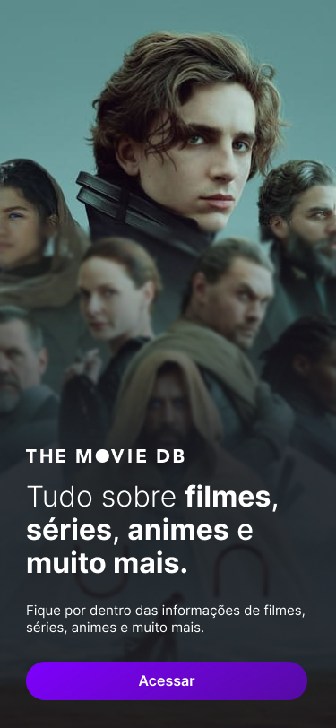

# Onboarding

Feature: [task.md](../task.md)
Source: [Figma frame "Onboard" (node 1:2)](https://www.figma.com/design/G4YiZkobsY5gJP94z8pFlh/TMDB--Community-?node-id=1-2)
Status: Confirmed

## Reference

## Layout
Frame 375×812dp, no scrolling in the design. Three layers, back to front:

1. **Background**: vertical linear gradient on the frame, `#303243` at 0% → `#3D458F` at 56.527%. It is
   fully covered by the artwork in the design.
2. **Artwork** (`image 4`): fills the frame (375×812dp), clipped to the frame. The image is scaled to
   160.8% of frame width × 111.39% of frame height (≈ 603×904dp), centered horizontally (left −30.4%) and
   top-aligned (top −0.03%), so the bottom of the image is cropped.
3. **Scrim** (`Rectangle 10`): 375×812dp over the artwork, backdrop blur 2dp. Vertical gradient, read top
   to bottom: transparent from 0% to 30.89%, ramps to `rgba(21, 21, 29, 0.85)` at 62.685%, solid
   `rgba(21, 21, 29, 0.85)` to 100%. (In Figma this is the rectangle flipped vertically with stops
   `rgba(21,21,29,0.85)` 37.315% → transparent 69.11%.)
4. **Content block** (`Frame 13`): 315×280dp, anchored to the bottom: 31dp from the bottom edge, 29dp from
   the left, 31dp from the right. Vertical column, gap 19dp, children start-aligned, content pushed to the
   bottom (justify end). Top to bottom: logo, headline, body, button.

### Adaptive layout (from user)
Not designed. Landscape, tablets and large fonts: the artwork keeps a full-bleed cover crop; the content block
stays bottom-anchored, centered, max width 315dp. If it doesn't fit (large font, short landscape height), the
content block scrolls and the button stays reachable. (AC-7, AC-8, EC-5)

### System bars (from user)
Edge-to-edge: artwork and scrim draw behind the status bar and navigation bar; system bar icons are light
(white). The content block keeps its 31dp bottom margin above the navigation bar / home indicator inset.

## Components
| Component | Values |
|---|---|
| Logo (`Group 11`) | Vector, 176.441×15dp, fill `#FFFFFF`; wordmark "THE MOVIE DB" → `assets/group_11.svg` |
| Headline (`29:47`) | Width 315dp, height 117dp (3 lines), Inter 32sp, line height 1.165 (≈ 37.3sp), `#FFFFFF`, start-aligned. Mixed weights: Light for "Tudo sobre ", Bold for "filmes", "séries", "animes", " muito mais.", Medium for ", " / ", " / " e". **App: a single Light weight, no bold (from user)** |
| Body (`29:50`) | Width 315dp, height 48dp, Inter Regular 15sp, line height 1.25 (≈ 18.75sp), `#FFFFFF`, start-aligned |
| Primary button (`Frame 12`) | Width 314dp, height 43dp (app: min height 48dp for the touch target, from user), padding 12dp all sides, corner radius 60dp (pill). Fill linear gradient 149.16°: `rgb(128, 0, 255)` / `#8000FF` at 0% → `rgb(84, 11, 161)` / `#540BA1` at 101.2% |
| Button label (`29:49`) | Inter SemiBold 16sp, line height normal, `#FFFFFF`, centered, single line |

No Figma variables or styles are bound to this frame; all values are raw.

## Copy
| Where | Text |
|---|---|
| Logo | TMDB official logo (vector, not text) (from user) |
| Headline (pt-BR) | Tudo sobre **filmes**, **séries**, **animes** e **muito mais.** |
| Body (pt-BR) | Fique por dentro das informações de filmes, séries, animes e muito mais. |
| Button (pt-BR) | Acessar |
| Headline (en) | All about **movies**, **series**, **anime** and **much more.** (from user; Light + Bold as in pt-BR) |
| Body (en) | Stay up to date on movies, series, anime and much more. (from user) |
| Button (en) | Get started (from user) |

## States
### Content
The only state (task.md `## UI states`): as in the reference.

### Navigating
After the button is tapped, the screen is replaced by Home; no designed visual change. Further taps have no
effect (EC-3).

## Dark mode
The design is dark only; there is no light variant. The app uses a dark theme throughout.

## Interactions
| Element | Action | Result | AC |
|---|---|---|---|
| Primary button | Tap | Records onboarding as completed and opens Home | AC-2, EC-1, EC-3 |
| Primary button | Press | Platform default feedback (Android ripple / iOS highlight) over the gradient pill (from user) | — |
| Screen | System Back | Leaves the app | AC-4 |
| Artwork, scrim, logo | — | Decorative; not announced by screen readers | AC-7 |

## Assets
| File | Original format | Size | Used in | Status |
|---|---|---|---|---|
| `assets/image_4.png` | PNG | 600×900px | Full-screen artwork | reference only, not shipped: film art; the app shows the frame's background gradient (`#303243` → `#3D458F`) as placeholder artwork until licensed art is supplied (from user) |
| `assets/group_11.svg` | SVG | 176.441×15 | Logo above headline | reference only, not shipped: replaced by TMDB's official logo (from user) |
| `assets/tmdb_logo_long.svg` | SVG | 423.04×35.4 (shown 179×15dp) | Logo above headline | shipped as `apps/cmp/feature/onboarding/ui` `drawable/tmdb_logo.xml`; TMDB's `blue_long_1` from the logos & attribution page, gradient colours kept (not the design's white) (from user) |

## Gaps
- [x] English copy — resolved (from user), see Copy.
- [x] Artwork license — resolved (from user): gradient placeholder; licensed artwork later.
- [x] Logo — resolved (from user): TMDB's official logo, `assets/tmdb_logo_long.svg`, in its own colours.
- [x] Screen-reader text for the headline — resolved: the headline is one plain string (no bold) marked as a
  heading, so it is read as one sentence (AC-7).

## Change log
- 2026-11-10: Initial version.
- 2026-11-11: Added English copy; artwork -> gradient placeholder, logo -> TMDB official logo (user decisions).
- 2026-11-12: Added the official TMDB logo file (gradient, not white).
- 2026-11-12: Headline ships in a single Light weight; the bold keywords are dropped (user decision).
- 2026-11-12: The placeholder artwork and the scrim ship as vector drawables (`drawable/onboarding_artwork_placeholder.xml`, `drawable/onboarding_scrim.xml`) instead of code gradients.
- 2026-11-12: Headline gap closed; button min height 48dp for the touch target (AC-7).
