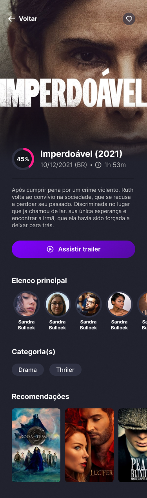

# Title details

Feature: [task.md](../task.md)
Source: [Figma frame "Show" (node 47:2)](https://www.figma.com/design/G4YiZkobsY5gJP94z8pFlh/TMDB--Community-?node-id=47-2)
Status: Confirmed

## Reference

## Layout
Frame 375×1267dp. Positions below are from the frame's top-left corner.

Background, back to front:
1. **Screen background** (frame fill): vertical linear gradient, `#303243` at 0% → `#15151D` at 65.394%,
   solid `#15151D` below.
2. **Artwork** (`Rectangle 22`): 375×493dp at 0, 0, image cropped to fill (cover). The design shows a portrait
   poster (sample 600×900px). **App (from user):** the poster; the backdrop when there is no poster (AC-12).
3. **Artwork fade** (`Rectangle 10`, flipped vertically): 375×1383dp at 0, 0 (taller than the frame). Transparent
   from the top to y ≈ 260, then a vertical linear fade to solid `#21222E` at y ≈ 412, solid `#21222E` below. In
   gradient terms (as exported, before the flip): stop `#21222E` at 70.2097% → transparent at 81.2003%. It
   blends the lower part of the artwork into the page and is the effective page color below the artwork.

Overlay controls (on the artwork):

| Element | Position (x, y) | Size |
|---|---|---|
| Back control ("Voltar", `Group 21`) | arrow 18, 36; label 48, 38 | arrow 24×24; whole group 78×24 |
| Favorite button (`Group 16`) | 313, 32 | 32×32 (right edge 30dp from the screen edge) |

Content, top to bottom (start padding 30dp, content width 315dp):

| Element | Position (x, y) | Size | Gap to next |
|---|---|---|---|
| Header (`Group 22`): rating ring + name + date line | ring 30, 376; name 103, 377; date line 103, 410 | ring 57×57; name 242 wide | — |
| Divider (`Line 1`) | 30, 454 | 311×1 | 20dp (→ synopsis 474) |
| Synopsis | 30, 474 | 315×108 (6 lines in the design) | 30dp (→ trailer button 612) |
| "Assistir trailer" button | 30, 612 | 315×44 | 46dp (→ "Elenco principal" 702) |
| "Elenco principal" heading | 30, 702 | 141×22 | 20dp (→ cast row 744) |
| Cast row | 30, 744 | 116 high (items 98 high) | 23dp (→ "Categoria(s)" 883) |
| "Categoria(s)" heading | 30, 883 | 112×22 | 20dp (→ chips 925) |
| Genre chips | 30, 925 | 31 high | 41dp (→ "Recomendações" 997) |
| "Recomendações" heading | 30, 997 | 206×22 | 20dp (→ posters 1039) |
| Recommendations row | 30, 1039 | 188 high | 40dp to the frame bottom (1267) |

- The header starts 117dp above the artwork's bottom edge (376 vs 493): it sits on the faded lower part of the
  artwork.
- Header: the name and date line start 16dp after the ring (ring right edge 87 → 103). The name's top is 1dp
  below the ring's top; the date line is 5dp below the name (name bottom 405 → 410).
- Divider: 22dp below the ring's bottom (433 → 454 is 21dp, with the 1dp line).

### Scrolling (from user)
- The whole screen scrolls vertically, the artwork included. Pull-to-refresh is on this vertical scroll (AC-17).
- "Voltar" and the favorite button stay fixed at their positions while the content scrolls under them.
- The cast row and the recommendations row scroll horizontally. They start at the 30dp padding and bleed to the
  right screen edge, as on Home.

## Components
| Component | Values |
|---|---|
| Back arrow (`Frame`, 47:115) | 24×24dp, `#FFFFFF` → `assets/ic_back_arrow.svg` |
| Back label (`47:147`) | "Voltar", Inter Bold 16sp, line height normal, `#FFFFFF`; 6dp after the arrow, top 2dp below the arrow's top |
| Favorite button, off (`Group 16`) | 32dp circle, fill `#303243` at 65% opacity; outline heart 18.73×18.73dp, `#FFFFFF`, centered (at 7.02, 7.02 inside the circle) → `assets/ic_favorite_button.svg` (circle and heart in one SVG) |
| Favorite button, on (from user) | Same circle; heart filled `#FF1F8A`. Not designed (AC-3) |
| Rating ring track (`Ellipse 2`) | 57dp circle, fill `#303243` |
| Rating ring center (`Ellipse 3`) | 45dp circle, fill `#15161D`, centered (6dp inset), leaving a 6dp ring |
| Rating ring progress (`Ellipse 4`) | Arc in the 6dp ring, `#FF1F8A`, round caps; starts at 12 o'clock and runs clockwise; its sweep is the score percentage (45% in the design) |
| Rating value (`47:58`) | "45" Inter Bold 15sp + "%" Inter Regular 15sp, line height normal, `#FFFFFF`, centered in the ring |
| Name with year (`47:47`) | "Imperdoável (2021)", Inter Bold 22sp, line height normal, `#FFFFFF`, width 242dp (one line in the design) |
| Release date (`47:48`) | "10/12/2021 (BR)", Inter Regular 16sp, line height normal, `#BBBBBB`. **App (from task.md AC-7):** no country code |
| Separator dot (`Ellipse 7`) | 4dp circle, `#BBBBBB`; 3dp after the date text, vertically centered on the line (y 418) → `assets/dot_separator.svg` |
| Clock icon (`Frame`, 47:98) | 19×19dp, `#BBBBBB`; 6dp after the dot → `assets/ic_clock.svg` |
| Runtime (`47:102`) | "1h 53m", Inter Regular 16sp, line height normal, `#BBBBBB`; 6dp after the clock |
| Divider (`Line 1`) | 311dp wide, 1dp stroke, `#000000` at 48% opacity |
| Synopsis (`47:60`) | Inter Regular 14sp, line height 1.25 (17.5sp), `#CCCCCC`, width 315dp, start-aligned, no line limit (EC-5) |
| "Assistir trailer" button (`Frame 12`) | 315dp wide, padding 12dp, height 44dp, corner radius 60dp (pill); fill linear gradient at 148.66°, `#8000FF` at 0% → `#540BA1` at 101.2%; content centered: play icon + 10dp gap + label |
| Play icon (`Frame`, 47:112) | 20×20dp, `#FFFFFF` at 90% opacity (baked into the SVG) → `assets/ic_play_circle.svg` |
| Trailer label (`94:9`) | "Assistir trailer", Inter SemiBold 16sp, line height normal, `#FFFFFF` |
| Section heading (`47:63`, `47:117`, `47:124`) | Inter Bold 18sp, line height normal, `#FFFFFF`, single line |
| Cast item | Column 75dp wide, 79dp step (4dp between columns); photo 60dp circle, image cropped to fill, with a 4dp `#303243` border outside it (68dp overall), centered in the column; name 7dp below the photo (photo top 0 → name top 67) |
| Cast name (`47:65`) | Inter Bold 12sp, line height normal, `#FFFFFF`, centered, width 75dp, height 31dp (2 lines: "Sandra / Bullock") |
| Genre chip (`Rectangle 2`) | 82×31dp in the design, corner radius 34dp (pill), fill `#303243`; label Inter Medium 15sp, line height normal, `#FFFFFF`, centered (label 47dp wide → 17.5dp horizontal padding; text top 7dp below the chip top); 14dp between chips |
| Recommendation poster | 124×188dp, corner radius 8dp, image cropped to fill (cover); 12dp gap (136dp step) |

No Figma variables or styles are bound to this frame; all values are raw.

## Copy
| Where | Text |
|---|---|
| Back (pt-BR / en) | Voltar / Back (en from user) |
| Trailer button (pt-BR / en) | Assistir trailer / Watch trailer (en from user) |
| Cast heading (pt-BR / en) | Elenco principal / Main cast (en from user) |
| Genres heading (pt-BR / en) | Categoria(s) / Genres (en from user) |
| Recommendations heading (pt-BR / en) | Recomendações / Recommendations (en from user) |
| Rating, no votes | NR (both languages, from user; task.md AC-6) |
| Rating, screen reader, no votes (en / pt-BR) | Not rated yet / Ainda sem avaliação (task.md AC-6) |
| Missing synopsis (en / pt-BR) | Synopsis not available. / Sinopse indisponível. (task.md AC-8) |
| Favorite, screen reader (en / pt-BR) | Favorite / Favorito, as a toggle (task.md AC-3) |
| Error message (en / pt-BR) | Couldn't load this title. / Não foi possível carregar este título. (from user) |
| Retry button (en / pt-BR) | Try again / Tentar novamente (from user) |

Name, date, runtime, synopsis, cast names, genre names and posters come from TMDB.

## States
### Content
As in the reference. Sections without data are left out (task.md AC-5, AC-9, AC-10, AC-11): no trailer button,
no "Elenco principal", no "Categoria(s)" or no "Recomendações"; the sections below move up. A missing synopsis
shows the missing-synopsis text in the synopsis style. A missing year, date or runtime is left out with its
separator (AC-7).

### Loading (from user)
Nothing cached for the title: the screen background with "Voltar" at its position; no artwork, no favorite
button (AC-4); a circular indeterminate spinner in `#FF1F8A`, centered on the screen (AC-13).

### Refreshing
Content stays visible; during pull-to-refresh the platform's pull-to-refresh indicator shows at the top (AC-17).
Not designed.

### Error (from user)
Load failed with nothing cached (AC-14, EC-13): as Loading, with, in place of the spinner, the error message and
below it a "Tentar novamente" pill, as Home's row error: message Inter Regular 15sp `#FFFFFF` at 50% opacity;
pill fill `#FF1F8A`, corner radius 70dp, padding 14dp horizontal / 6dp vertical, label Inter SemiBold 16sp
`#FFFFFF`. Centered on the screen.

## Dark mode
The design is dark only; there is no light variant. The app uses a dark theme throughout.

## Interactions
| Element | Action | Result | AC |
|---|---|---|---|
| "Voltar" (arrow + label) | Tap | Returns to the previous screen | AC-2 |
| Favorite button | Tap | Toggles favorite; heart outline ↔ filled `#FF1F8A`; each tap toggles once | AC-3, EC-1 |
| Favorite button | Screen reader | Toggle "Favorite" / "Favorito" with its on/off state | AC-3 |
| "Assistir trailer" | Tap | Opens the trailer in the YouTube app or the browser; once on repeated taps | AC-5, EC-2, EC-3 |
| Cast item | Tap | Nothing | AC-9 |
| Genre chip | Tap | Nothing | AC-10 |
| Recommendation poster | Tap | Opens that title's details on top; once on repeated taps | AC-11, EC-2, EC-7 |
| Recommendation poster | Screen reader | Announced as a button with the title's name | AC-11 |
| Artwork | Screen reader | Skipped (decorative) | AC-12 |
| "Tentar novamente" | Tap | Loads the title again | AC-14 |
| Screen | Pull down | Refreshes the title | AC-17, EC-11 |
| Cast row, recommendations row | Horizontal swipe | Scroll sideways | — |

## Assets
| File | Original format | Size | Used in | Status |
|---|---|---|---|---|
| `assets/ic_back_arrow.svg` | SVG | 24×24 | Back control | downloaded |
| `assets/ic_favorite_button.svg` | SVG | 32×32 | Favorite button (off): 65% `#303243` circle + outline heart | downloaded |
| Filled heart | — | — | Favorite button (on) | missing: not in the design (from user: filled heart `#FF1F8A`) |
| `assets/ic_clock.svg` | SVG | 19×19 | Date line, before the runtime | downloaded |
| `assets/dot_separator.svg` | SVG | 4×4 | Date line, between date and clock | downloaded |
| `assets/ic_play_circle.svg` | SVG | 20×20 | "Assistir trailer" button | downloaded |
| `assets/rating_ring_track.svg` | SVG | 57×57 | Rating ring, outer circle | downloaded, reference only: the ring is drawn from the values above |
| `assets/rating_ring_inner.svg` | SVG | 45×45 | Rating ring, center | downloaded, reference only |
| `assets/rating_ring_progress.svg` | SVG | 27.78×50.34 | Rating ring, 45% arc | downloaded, reference only: the arc's sweep depends on the score |
| `assets/divider_line.svg` | SVG | 311×1 | Divider below the header | downloaded, reference only |
| `assets/rectangle_10_overlay.svg` | SVG | 375×1383 | Artwork fade (exported unflipped; the design flips it vertically) | downloaded, reference only |
| `assets/backdrop_sample.png` | PNG | 600×900px | Artwork | downloaded, reference only: sample poster; the app loads artwork from TMDB at runtime |
| Cast photos (7 in the frame) | PNG | 136×136px (68dp @2x, border included) | Cast row | not downloaded: sample photos; the app loads them from TMDB at runtime |
| Recommendation posters (8 in the frame) | PNG | 124×188 | Recommendations row | not downloaded: sample posters; the app loads them from TMDB at runtime |

## Tokens
Design-system tokens the screen uses in all three apps (`docs/features/design-system/`). Measurements above
stay as the Figma record.

| Element | Spacing | Text | Shape | Color |
|---|---|---|---|---|
| Screen | `xxl` sides; content 376 from the top; `xxxl` bottom | — | — | `surface`; artwork fades to `surface` (artwork 492 high) | |
| Back control | `xs` start; `sm` pill padding; `xs` arrow gap; pill min height 32 | `titleMedium` | full (pill) | `surfaceContainerHigh` 65%, `onSurface` (iOS: system bar on `surfaceContainerHigh`) | |
| Favorite button | `xl` end | — | full (circle) | `FavoriteHeart` (outline `onSurface` / filled `secondary`) | |
| Rating ring | `md` to the name; ring 56, stroke 6 | `titleMedium` value, capped and auto-sized | full (circle) | track `surfaceContainerHigh`, center `surface`, arc `secondary`, value `onSurface` | |
| Name and date line | `xxs` name → date; dot 4 with `xxs`/`xs`; clock `iconSmall`, `xs` gap | `titleLarge`, `bodyLarge` | — | `onSurface`, `onSurfaceVariant` | |
| Divider and synopsis | `lg` above and below the divider; `xxl` to the trailer | `bodyMedium` | — | divider `outlineVariant` (`borderWidth`), synopsis `onSurface` | |
| Trailer button | `sm` padding; icon `iconSmall`, `sm` gap; min height 44 | `titleMedium` | full (pill) | `primary` → `primaryContainer`, `onPrimary` | |
| Section headings | `xxxl` above; `md` (cast) or `lg` (others) below | `titleLarge` | — | `onSurface` | |
| Cast | `xxs` between items and photo → name; item 76, photo 60, border 4 | `labelMedium` (2 lines) | full (circle) | `surfaceContainerHigh`, `onSurface` | |
| Genre chips | `md` between and padding; `sm` between lines; min height 32 | `titleMedium` | full (pill) | `surfaceContainerHigh`, `onSurface` | |
| Recommendations | `PosterRowDefaults`; `sm` between | — | `small` | — | |

## Gaps
- [ ] Artwork placeholder when the title has neither poster nor backdrop (needed for AC-12)
- [ ] Cast photo placeholder (needed for AC-9); and the recommendation poster placeholder tile (AC-11), e.g.
  Home's poster placeholder (fill `#36076B`, name Inter SemiBold 14sp `#FFFFFF`)
- [ ] Genre chips: width from the label or fixed 82dp, and whether they wrap to more lines when there are many
  (needed for AC-10, EC-12)
- [ ] Long names: the name wraps (EC-4) but the date line position below it is not designed for 2+ lines
- [ ] "Voltar" has no background in the design; readability over scrolled content once it stays fixed (AC-12)
- [ ] System bars: edge-to-edge as on Home (light status bar icons, artwork behind the status bar)? Not designed
- [ ] Press feedback for the trailer button, favorite button and posters (not designed; e.g. platform default)
- [ ] Minimum touch target for the 32dp favorite button and the 24dp-high back control (task.md constraints)

## Change log
- 2026-11-20: Initial version.
- 2026-11-20: Confirmed by the user.
- 2026-11-24: Added Tokens (design system).
